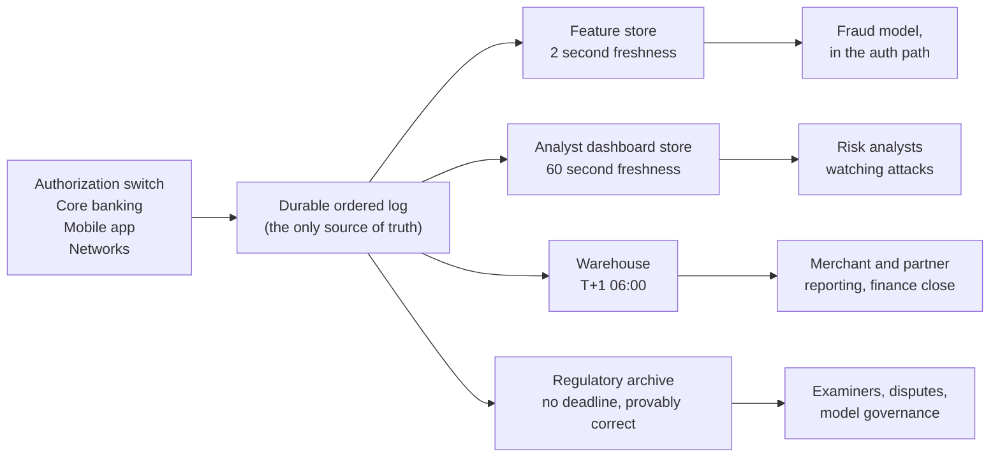

# What "Design a Pipeline for Billions of Transactions Daily" Is Really Asking

This collection exists to answer one interview question thoroughly:

> "How would you design a data pipeline to process billions of transactions daily?"

It is a question a card issuer or bank asks, and it is asked because analytics and reporting at
a bank are not a convenience. They are how fraud gets stopped, how regulators get answered, and
how the books get closed. A broken dashboard at a social network is an annoyance. A broken
general-ledger feed at a bank is a material weakness in internal controls, which is a phrase
that appears in an annual report.

Before designing anything, it is worth being precise about what the question is testing, because
the obvious reading of it leads to a weak answer.

---

## The obvious answer, and why it scores poorly

Here is the answer most candidates give, more or less verbatim:

> Extract the transactions from the payment systems using Kafka. Transform them — clean the
> data, normalize the fields, mask the sensitive ones. Load them into a warehouse like Snowflake
> or Redshift. Then build risk dashboards for fraud, merchant reporting for volume summaries, and
> compliance extracts for regulators. Use batch for the nightly reports and streaming for the
> fraud dashboards, because streaming is more expensive.

Nothing in that paragraph is false. It is a correct summary of the shape of the system. And it
is a weak answer, for four reasons that are worth looking at one at a time, because each of them
points at a document in this collection.

### It accepts "billions" without taking it apart

The word "transactions" is doing an enormous amount of hidden work. At Monarch Card Services —
the fictional issuer this collection designs for — there are 99 million card authorizations a
day and 3.06 billion events a day. Both numbers are real. They differ by a factor of 31.

If you design for "billions of transactions," you will quietly design as though 3 billion
money-moving records exist, and you will reach for architecture that is enormously over-built
for the 99 million that actually move money and under-built for nothing in particular. If
instead you spend ninety seconds decomposing the number, you discover that:

- 3.2% of the volume is money and needs exactly-once semantics, double-entry validation, and
  seven-year immutable retention.
- 69% of the volume is mobile clickstream, where losing 0.1% of events is genuinely fine and
  anyone who says otherwise is wasting the company's money.
- The remaining 28% is fraud rule-hit telemetry, which is high volume, low value per record, and
  has a 25-month life.

Three populations, three sets of requirements. **The decomposition is the answer**, and
document 01 does it in full.

### It treats ETL as the architecture

"Extract, transform, load" describes a *data movement*, not a system. Saying it out loud
communicates that you know the words. It does not communicate any decision.

Every hard problem in this design lives in the gaps between those three letters:

- Where exactly does the card number stop existing in plaintext, and what boundary enforces that?
  (Document 02.)
- What is the durable thing that all the loads are derived from, and can you rebuild any of them
  from it? (Documents 03 and 05.)
- When the same authorization arrives twice because a consumer restarted, which component
  notices? (Document 08.)
- When the transform logic changes in March, how do you make the January numbers consistent
  without corrupting the regulatory record? (Documents 05 and 09.)

None of that is addressed by the letters E, T and L. A better frame, and the one this collection
uses, is:

> There is one durable, ordered, replayable log of what happened. Everything else — the
> warehouse, the dashboards' store, the feature store, the regulatory extracts — is a
> **materialisation** of that log, built by a job you can re-run, and is therefore disposable
> and rebuildable.

That frame is what lets you answer "the transform had a bug for six weeks" without panicking.

### It makes batch-versus-streaming a taste question

"Batch is cheaper and easier, streaming is expensive but needed for fraud." True, and
insufficient, because it does not tell the interviewer *how you would decide* for a consumer
they have not mentioned yet.

The decision is not about the technology's cost. It is about one measurable quantity:

> **What does it cost the business if this particular consumer reads data that is six hours
> stale?**

For the fraud feature store, the answer has a dollar figure attached: a card-testing attack runs
to completion in roughly 20 minutes, so six-hour-stale velocity counters mean you detect the
attack after it has finished, and the loss is the full attack. For the merchant reporting feed,
six-hour-stale means the partner's 06:00 meeting has yesterday's numbers instead of yesterday's
numbers, which is to say: no difference whatsoever.

Same company, same data, same pipeline team. Opposite answers. Document 07 turns this into a
decision procedure with four questions you can apply to any consumer in about a minute.

### It omits the thing the bank actually cares about

The obvious answer lists compliance third, as "provide regulators with clean, immutable data,"
and moves on.

At a bank, the compliance consumer is the one with the *strictest* requirement in the entire
system, and it is not a latency requirement. It is this:

> Given any date in the past seven years, reproduce exactly what the system knew and decided on
> that date — not what we now believe to be true, but what the record said then — and be able to
> prove the reproduction is faithful.

That requirement rules out a surprising number of otherwise reasonable designs. It rules out
overwriting rows. It rules out "we fixed the historical data." It rules out a warehouse table
whose definition changed without a version. It demands that your transform code be versioned
alongside the data it produced, and that the lineage from a regulatory figure back to the
original authorization message be mechanically traversable.

Meeting it is mostly about *restraint* — not deleting, not overwriting, not correcting in place —
and it is cheap if you design for it on day one and extremely expensive to retrofit. Document 09
is about this.

---

## The four consumers, and why they are the real structure

Rather than drawing the pipeline as stages, draw it as consumers, because the consumers are what
differ and the stages are what they share.

Four consumers. Each one gets a different store, a different delivery guarantee, a different
retention, and a different cost per event. They share exactly one thing: the log.

Here is the property that makes this structure worth the extra boxes. **Each of those four
materialisations can be deleted and rebuilt from the log.** The feature store can be rebuilt in
20 minutes. The dashboard store in 4 hours. The warehouse in a weekend. That means a bug in any
one of them is a re-run, not an incident — provided the log itself is intact and retained long
enough, which is why document 03 spends so much time on log retention.

---

## What the interviewer is actually testing

Having asked and been asked this question, the signal being looked for breaks down roughly like
this. Four things are being checked, and they are not weighted equally.

**1. Do you interrogate the requirement, or implement it?** The single highest-value move in the
first five minutes is to refuse the word "billions" and decompose it. An engineer who designs for
a number they were handed, without checking what the number contains, will do the same thing to
a product requirement and ship the wrong system. This is being tested deliberately. The number
in the question is *designed* to be too round.

**2. Do you know where money is different from data?** Banks hire data engineers who understand
that a dropped clickstream event and a dropped ledger posting are not the same category of
problem. The specific knowledge being probed: double-entry, idempotency on a money path,
reconciliation against a counterparty's records, and the fact that "we lost some events" is a
condition you must report to a regulator on one stream and an acceptable, unremarkable loss on
another.

**3. Can you reason about latency with numbers rather than adjectives?** "Real-time" is not an
answer. "The authorization has a 150-millisecond budget, the pipeline is allotted 8 of those
milliseconds, so the pipeline cannot be in the request path — it has to pre-compute into a
key-value store" is an answer. The difference is whether you have ever had to hit a latency SLO.

**4. Do you treat compliance as a design input or a checkbox?** At a bank, the person
interviewing you has been through an examination. They know that the expensive part is not
producing the report; it is proving the report. Candidates who say "immutable audit log" without
being able to explain what makes it provably immutable, who can attest to it, and how you
reproduce a figure as of a past date, are repeating a phrase rather than making a claim they can
defend.

There is also a thing *not* being tested, and candidates waste time on it: naming the specific
products. Snowflake versus Redshift versus BigQuery is close to irrelevant to this question. You
will be asked to justify a choice, and a one-sentence justification tied to a constraint is
enough. Spending eight minutes comparing warehouse pricing models is eight minutes not spent on
the ledger.

---

## How this collection is organised

The documents follow the data, but each one is written around a decision rather than a
component.

- **01** fixes the running system and derives every number. Everything else refers back to it.
- **02–04** are the real-time path: the ingestion edge and the card-data boundary, the transport
  log and its partitioning, and the streaming transforms that feed the feature store.
- **05–06** are the analytical path: the lake, and the stores that serve dashboards and reports.
- **07** is the batch-versus-streaming decision, as a procedure.
- **08–09** are the two things banks care about more than anything in 02–07: correctness proved
  by reconciliation, and compliance proved by reproducibility.
- **10–11** are what happens when it breaks and what it costs.
- **12** is the interview itself — a 45-minute script, the whiteboard, and the questions with
  full spoken answers.

If you have 20 minutes before an interview, read **01**, the decision procedure in **07**, and
the opening script in **12**. If you have an evening, read all of it in order.

---

## When this whole collection does not apply

Worth saying plainly, because designing for scale you do not have is its own failure mode.

If your transaction volume is under roughly **5 million a day**, none of this is your design.
Five million rows a day is 1.8 billion rows a year, which fits comfortably in a single Postgres
instance with sensible partitioning, and you can serve dashboards, reporting, and compliance
extracts from it with read replicas. Adding Kafka, Flink, a lake, and a warehouse to that
situation does not buy you capability — it buys you four more things that can page you at 03:00.

The specific thresholds at which each piece starts earning its keep:

| Add this | When |
|---|---|
| A durable log in front of the warehouse | More than two independent consumers need the same events, or you have been burned by a load job that could not be re-run |
| Stream processing | A consumer's freshness SLO is under about 5 minutes and the cost of staleness is quantifiable |
| A separate lake under the warehouse | Raw retention exceeds what you will pay warehouse prices for — usually past 90 days at this volume |
| A dedicated analytical store for dashboards | Dashboard queries are degrading the warehouse for the reporting jobs, or concurrency exceeds what the warehouse serves cheaply |
| A feature store | Something in a request path needs aggregates it cannot compute in its latency budget |

Each row is a cost — operational, not just financial. Pay it when the trigger fires, not before.

---

## What to take away

1. **The question's premise is the first thing to test.** "Billions of transactions" at an issuer
   is 99 million money events and 3 billion non-money events. Decomposing that in the first five
   minutes is the highest-value move available.
2. **ETL is a data movement, not an architecture.** The architecture is: one durable ordered log,
   and several rebuildable materialisations of it.
3. **Batch versus streaming is decided per consumer, by the measured cost of staleness** — not by
   the cost of the technology and not by taste.
4. **The compliance consumer has the weakest latency requirement and the strongest correctness
   requirement**, which is the opposite of what most candidates assume, and it constrains the
   design more than the fraud path does.
5. **Four things are being tested:** whether you interrogate requirements, whether you know where
   money differs from data, whether you reason about latency numerically, and whether compliance
   is a design input for you or a word you say.
6. **Under about 5 million transactions a day, build none of this.** One Postgres instance with
   partitioned tables and read replicas is the correct answer, and saying so when it is true is
   itself a strong signal.
