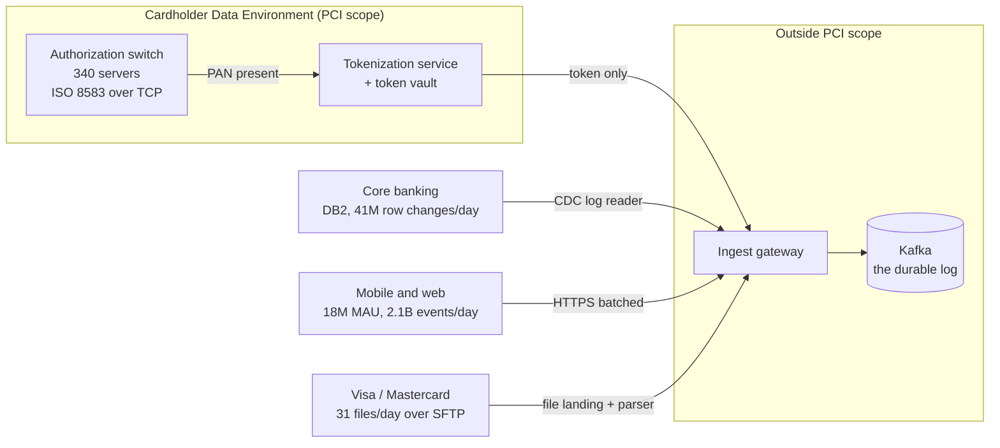
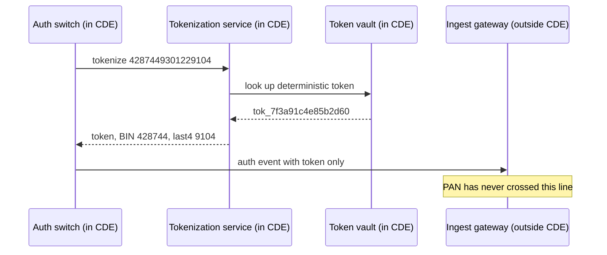

# The Ingestion Edge, and the Boundary the Card Number Must Never Cross

"Extract: ingest raw transactions from payment systems via Kafka" is one line in the outline and
about four months of work in reality. This document is about what happens between a thing
occurring in the world and that thing being a durable record in the log.

Two problems dominate, and they pull in opposite directions.

The first is that **the authorization switch cannot be allowed to wait for your pipeline.** It
has 150 milliseconds to answer Visa and it is going to spend them on deciding, not on publishing.
Anything you put in its path is a new way for a card network to see Monarch as unavailable.

The second is that **the card number must stop existing in plaintext at a precise, auditable
point**, and if you get that point wrong, every downstream system becomes subject to PCI DSS
audit. That is not a compliance inconvenience; it is a multi-million-dollar annual cost and a
constraint on who may run a query.

Getting both right at once is most of the design of the edge.

---

## The four sources, which are genuinely different

Candidates often say "ingest from the payment systems" as though that were one integration. It
is four, and they have nothing in common except that they end in the same log.



**The authorization switch** speaks ISO 8583, a binary message format from 1987 in which fields
are identified by position and a bitmap says which are present. It runs on 340 servers in two
data centres. It is the most latency-sensitive system in the bank and the most conservative; its
owners will not accept a library that allocates memory unpredictably.

**Core banking** is a DB2 system of record for accounts, limits, and statements. You do not query
it — the people who run it have a hard concurrent-query limit and will notice. You read its
transaction log, through change data capture.

**The mobile app** emits clickstream from a client you do not control, over the public internet,
from devices that go offline in elevators. Events arrive late, duplicated, out of order, and
sometimes forged.

**The networks** send files. Not streams — files, on a schedule, over SFTP, with a trailer record
containing counts and totals. Thirty-one of them a day. This is the stream everyone forgets, and
it is the one that tells you whether the other three are correct, which is document 10's subject.

Treating these as one integration is the first thing that goes wrong. They need four different
ingestion mechanisms, four different failure modes, and four different definitions of "late."

---

## Problem one: you cannot put your pipeline in the authorization path

### The naive version

The obvious design is the one everybody draws first:

```
auth server → (synchronous publish to Kafka) → respond to Visa
```

Walk through what happens when the Kafka cluster has a leader election. A partition leader fails;
the controller elects a new one; producers see `NOT_LEADER_FOR_PARTITION`, refresh metadata, and
retry. This takes a few hundred milliseconds in the good case and several seconds if the
controller is itself under stress.

During those seconds, every authorization on every one of the 340 servers is blocked behind a
publish that is not completing. At 6,400 authorizations per second, a 4-second stall is
**25,600 authorizations** that got no answer. Visa stands in for all of them, using static rules
with no knowledge of current balances or the last five minutes of fraud signal.

So the cost of a routine, expected, perfectly normal Kafka operation became a bulk fraud exposure
and a stand-in event the network will ask about. That is the wrong coupling, and no amount of
producer tuning fixes it, because the problem is the word "synchronous."

### What actually works

Three properties, in order of importance:

**1. The publish is fire-and-forget relative to the decision.** The auth server writes the event
to an in-process ring buffer and returns to deciding. A separate publisher thread drains the
buffer to Kafka. The decision never observes the publish outcome.

**2. The ring buffer spills to local disk when Kafka is unavailable.** Sized for a full
operational window — Monarch sizes it for 4 hours at peak:

```
4 hours × 3,600 s × (6,400 auth/s ÷ 340 servers) × 1,400 bytes
= 4 × 3,600 × 18.8 × 1,400
= 379 MB per server
```

Round up, give it 2 GB, and the question "can we survive a four-hour Kafka outage without losing
authorization records" has the answer "yes, with five times the headroom." A 2 GB file on a
server that already exists is the cheapest insurance in this entire architecture.

**3. The buffer has a defined behaviour when it fills, decided in advance and written down.**
When local disk is full, the switch **drops the telemetry and keeps authorizing.** It increments
a counter that pages the data platform team and continues answering Visa.

That third one is a decision people avoid making, so it gets made badly at 03:00 by whoever is on
call. State it explicitly in an interview, because it demonstrates that you know what the system
is for:

> If I have to choose between losing an analytics event and failing an authorization, I lose the
> analytics event every time. The authorization *is* the product. But this is only acceptable
> because of what comes next — the network clearing file will tell me, the following day, exactly
> how many transactions I am missing, so the loss is bounded and measurable rather than silent.

That second sentence is what separates a considered trade-off from negligence. You are not
accepting unbounded data loss; you are accepting a loss that a counterparty will quantify for you
within 24 hours.

---

## Problem two: where the card number stops

### What PCI DSS actually constrains

The **Primary Account Number** (PAN) is the 16-digit number on the card. Under PCI DSS, any
system that stores, processes, or transmits PAN is part of the **Cardholder Data Environment**,
usually shortened to CDE. Systems in the CDE are subject to roughly 300 testable requirements
covering network segmentation, access control, logging, key management, vulnerability scanning,
and annual assessment by a Qualified Security Assessor.

The practical consequence is simple and severe: **every system in the CDE costs more to run,
changes more slowly, and can be queried by fewer people.** An analyst cannot get ad-hoc access to
a CDE system by filing a ticket.

So the governing principle of PCI engineering is not "secure the CDE." It is **make the CDE as
small as possible.** The term for this is *scope reduction*, and it is the single most valuable
thing you can know about payments compliance going into this interview.

### The mistake: masking as a transform step

The outline in the question says "Transform: clean and normalize data (e.g., masking sensitive
fields)." Read that carefully. It places masking in the *transform* stage — which is to say,
after the data is already in Kafka.

Follow the consequence. If the PAN is in a Kafka topic, then:

- Kafka is transmitting and storing cardholder data, so **the Kafka cluster is in the CDE.**
- Kafka's replicas, its backups, and the EBS volumes underneath are in the CDE.
- Every consumer group that reads the raw topic is in the CDE.
- The Flink cluster doing the masking is in the CDE.
- The checkpoint storage Flink writes to is in the CDE.
- Any dead-letter topic that received a malformed record containing a PAN is in the CDE, and
  dead-letter topics are exactly the ones nobody remembers to scope.

You have now put your central nervous system inside the most expensive compliance boundary in
the company, in order to save writing one service. The annual assessment cost difference is
substantial, and the operational cost — who may debug a Kafka partition at 03:00 — is worse.

### The fix: tokenize before publish, inside the CDE

The card number is replaced with a token *at the edge, inside the existing CDE, before anything
is published*. The CDE boundary is then exactly: the 340 auth servers, the tokenization service,
and the token vault. Nothing else.



Three properties make the token usable for analytics, and they are what an interviewer will
probe:

**The token is deterministic.** The same PAN always produces the same token. Without this you
cannot group transactions by card, which destroys every fraud feature and most reporting. This is
the property that makes tokenization different from hashing-with-a-random-salt.

**The token is not reversible without the vault.** It is a random surrogate recorded in a lookup
table, not a transformation of the PAN. A format-preserving *encryption* scheme would also work
but makes key rotation into a re-encryption of history, which the vault approach avoids.

**The BIN and last four digits travel in the clear, as separate fields.** The first six digits
(the Bank Identification Number) identify the issuing bank and card product, which you need for
analysis. The last four are what a customer service agent reads back to a customer. Both are
explicitly permitted to be stored outside the CDE under PCI DSS. Together they let you answer
almost every analytical question without ever needing the PAN.

The result is the sentence you want to be able to say:

> The lake has never contained a card number. Not masked, not encrypted — never present. So the
> lake is not in PCI scope, and an analyst can be granted access to it through a normal access
> review rather than a CDE onboarding.

### What about the other sensitive fields

PAN is the one with an audit regime attached, but it is not the only field that needs handling.
Monarch classifies fields into four tiers at ingest, and the tier determines where the field may
live:

| Tier | Fields | Treatment | May it reach the lake |
|---|---|---|---|
| **Prohibited** | Full magnetic stripe track data, CVV, PIN block | Must never be stored after authorization, by PCI DSS, under any circumstances | No — dropped at the edge, not even tokenized |
| **Tokenized** | PAN | Replaced by deterministic token in the CDE | Only as a token |
| **Restricted** | Name, address, SSN, date of birth, device fingerprint | Stored, but in a separately-governed schema with column-level access control | Yes, access-controlled |
| **Open** | Amount, merchant ID, MCC, response code, timestamps, token, BIN, last4 | No restriction | Yes |

The first row is the one that catches people. CVV and track data may be used during the
authorization and then must be destroyed. Not retained in a secure vault — **destroyed**. A
pipeline that faithfully logs the entire ISO 8583 message, field 35 included, is a PCI violation
from its first record, and "we encrypted it" is not a defence.

This is why the edge needs a **field allowlist rather than a denylist**. A new field appears in a
network message; with a denylist it flows straight through to the lake and nobody notices for
nine months. With an allowlist it is dropped and a counter increments, and someone goes and
classifies it. The failure mode of an allowlist is a missing field, which someone complains about
within a day. The failure mode of a denylist is a compliance finding, which someone complains
about in a year.

---

## Problem three: the schema contract

Three hundred and forty auth servers, a core banking CDC reader, a mobile SDK shipped in an app
with a six-week release cycle, and four network file formats all write into the log. Something
has to say what a valid record looks like, or the log becomes a swamp and every consumer
implements its own parsing bug.

### Why "just use JSON" fails at this volume

JSON is self-describing and permissive, which sounds like a virtue and is the problem. At
Monarch's volume:

- **Size.** The field names repeat in every record. `app.clickstream` at 900 bytes per record in
  JSON is roughly 410 bytes in Avro with the same content — the field names were 54% of it. Over
  2.1 billion events a day that difference is **1,029 GB per day** of network and storage, before
  replication.
- **No rejection point.** A producer that starts sending `amount` as the string `"47.12"` instead
  of the integer `4712` does not fail. It succeeds, and the consumer fails, two hours later, in a
  different team's pager rotation.
- **No evolution rules.** Nothing distinguishes a compatible change from a breaking one, so every
  schema change is a coordination meeting.

### What Monarch does

**Avro with a schema registry.** Every topic has a registered schema; producers serialize against
it and the registry refuses incompatible registrations.

The compatibility mode matters, and it is a real design decision rather than a default to accept:

- **`BACKWARD`** means new schemas can read old data. Good for consumers; it means a consumer can
  be upgraded first.
- **`FORWARD`** means old schemas can read new data. Good for producers; it means a producer can
  be upgraded first.
- **`FULL`** is both. Expensive — in practice it only permits adding or removing optional fields
  with defaults.

Monarch uses **`FULL` for money streams and `BACKWARD` for clickstream**, and the reason is
deployment order. You cannot upgrade 340 authorization servers and all their consumers at the
same instant; there will be a window of hours where both versions run. `FULL` is what makes that
window safe. The clickstream, by contrast, has one producer — the app — and the app's old
versions live for months in users' hands, so `BACKWARD` with the consumer upgraded first is
sufficient and less restrictive.

**Field semantics live in the schema, not in a wiki.** Each field carries documentation and the
classification tier from the table above, as a schema property. That is what lets the ingest
gateway enforce the allowlist mechanically instead of from a list someone maintains by hand:

```
{ "name": "pan_token", "type": "string",
  "doc": "Deterministic token for the PAN. Never the PAN itself.",
  "monarch.tier": "tokenized",
  "monarch.pii": true }
```

When the tier is in the schema, "is this field allowed in the lake?" is a question the pipeline
answers, not a question a human answers.

---

## Problem four: files are not streams, and pretending otherwise causes incidents

The 31 daily files from Visa and Mastercard are a different ingestion problem and deserve their
own mechanism.

A file has properties a stream does not:

- It has a **trailer record** stating how many detail records it contains and their total amount.
  This is a free completeness check and you should treat it as mandatory.
- It can be **delivered twice**. SFTP retries happen.
- It can be **delivered partially** — the sender is still writing when you start reading.
- It can be **late**, and lateness is measured in hours, not milliseconds.
- It may be **superseded** by a corrected version the next day, with the same logical content and
  a different sequence number.

The ingest rules that follow from those properties:

**Only read files the sender has finished writing.** Either the sender writes `FILE.pgp` then
`FILE.done`, or you wait for the file size to be stable across two polls 60 seconds apart. Reading
a file mid-write produces a truncated day of clearing data, which you will discover during
reconciliation three days later.

**Validate the trailer before publishing a single record.** Count and sum the detail records; if
they do not match the trailer, publish nothing and raise an alert. A file that fails its own
trailer check is not a data quality problem to be cleaned downstream — it is a transmission
failure, and the correct response is to request retransmission, not to ingest 94% of a day.

**Make ingestion idempotent on the file, not on the record.** Record the SHA-256 of every file
processed in a control table. If the same checksum appears again, skip it and log. If the same
logical file identifier appears with a *different* checksum, that is a corrected file — stop, do
not auto-ingest, and page someone, because applying a correction is a decision with ledger
consequences.

**Publish the file's records into the same log as everything else**, with a header noting the
source file identifier and its line number. Six months later, when a single clearing record is
disputed, "which file did this come from and what line was it on" has to be answerable in one
query.

---

## What the gateway does, concretely

Pulling it together. The ingest gateway sits between the sources and the log and does exactly
five things, deliberately kept few, because anything it does is on a path that cannot be slow:

1. **Authenticate the producer** (mutual TLS for the switch and CDC; signed tokens for the mobile
   SDK).
2. **Validate against the registered schema**, rejecting rather than coercing.
3. **Apply the field allowlist** and drop anything not classified.
4. **Stamp two timestamps** — `event_time` (when the thing happened, from the producer) and
   `ingest_time` (when the gateway saw it). Document 04 depends on both existing, and
   retrofitting `ingest_time` onto historical data is impossible.
5. **Route to the correct topic**, with the partition key the topic's design requires.

What it deliberately does *not* do: enrichment, joins, deduplication, aggregation, or business
logic. Every one of those is a transform, every transform has bugs, and a bug in the gateway is
unrecoverable because the data never reached the log. A bug in a downstream transform is a
re-run. **Keep everything you can on the replayable side of the log.**

Rejected records go to a per-topic **quarantine topic**, with the raw bytes, the schema that was
expected, and the specific validation failure. Two rules about quarantine, both learned the
expensive way:

- **Quarantine topics are in the same PCI scope as the topic they shadow.** A rejected auth record
  may contain anything, including fields that failed classification, so quarantine for a CDE-
  adjacent stream must be treated as CDE-adjacent. This is the dead-letter oversight mentioned
  earlier and it is extremely common.
- **A quarantine rate above zero is an alert, not a dashboard.** Monarch alerts at any sustained
  rejection on money streams and at 0.05% on clickstream. The number for money streams is zero
  because a rejected authorization record is a transaction the bank cannot prove it processed.

---

## What to take away

1. **The authorization switch publishes asynchronously, through a ring buffer that spills to
   local disk** sized for a four-hour outage — 379 MB per server, provisioned at 2 GB. A
   synchronous publish makes a routine Kafka leader election into a bulk stand-in event at the
   card networks.
2. **When the buffer fills, drop telemetry and keep authorizing** — and say so deliberately. The
   loss is acceptable only because the network clearing file quantifies it within 24 hours.
3. **Tokenize the card number inside the existing CDE, before publishing.** Masking as a transform
   step puts Kafka, Flink, checkpoint storage, and every dead-letter topic inside the PCI
   boundary. Making the cardholder data environment as small as possible is the governing
   principle of PCI engineering, and this is where that principle is applied or lost.
4. **The token must be deterministic**, or you cannot group by card and every fraud feature dies.
   BIN and last four travel in the clear and answer most analytical questions by themselves.
5. **CVV, PIN blocks, and track data must be destroyed after authorization, not stored securely.**
   A pipeline that faithfully logs the whole ISO 8583 message is non-compliant from its first
   record.
6. **Use a field allowlist, not a denylist.** An allowlist fails by dropping a field, which
   someone notices in a day. A denylist fails by leaking one, which someone notices in a year.
7. **Avro with a schema registry, `FULL` compatibility on money streams, `BACKWARD` on
   clickstream** — the mode follows from deployment order, not from preference. JSON costs an
   extra 1,029 GB a day on clickstream alone and has no rejection point.
8. **Files are not streams.** Wait for completion, validate the trailer before publishing
   anything, make ingestion idempotent on the file checksum, and never auto-apply a corrected
   file.
9. **The gateway does five things and no transforms.** Everything else belongs downstream of the
   log, where a bug is a re-run rather than permanent data loss.
10. **Quarantine topics inherit the PCI scope of the topic they shadow**, and a non-zero
    quarantine rate on a money stream is an alert rather than a metric.
