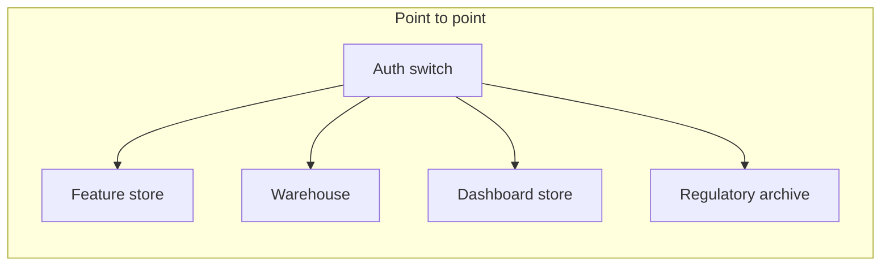

# The Transport Log: Topics, Partition Keys, and What Ordering Actually Buys You

Document 02 got records to the edge of the log. This document is about the log itself — which is
the one component that everything else depends on, and the one where a decision made in week two
is painful to change in year two.

The decisions in this document are, in order of how expensive they are to get wrong:

1. **The partition key**, which fixes what you can order and what will skew. Changing it later
   means re-keying every historical record and rebuilding every stateful consumer.
2. **The retention**, which fixes how far back you can replay. Too short and your rebuild
   capability is theatre.
3. **The topic boundaries**, which fix who can be deployed independently of whom.
4. **The partition count**, which is annoying to increase and the only one of the four that is
   merely annoying.

---

## Why a log at all, rather than writing to the stores directly

Worth establishing before the details, because the reason determines the configuration.

The alternative design is point-to-point: the auth switch writes to the feature store, and to the
warehouse loader, and to the dashboard store. No log in the middle.



Count the problems. The switch now has four dependencies instead of one, and must handle four
sets of failure modes. Adding a fifth consumer means changing and redeploying the authorization
switch — the most change-averse system in the bank. If the warehouse loader has a bug for six
weeks, the data it should have received is gone; there is nowhere to re-read it from. And the
four stores can disagree with no way to determine which is right, because there is no record of
what was sent.

The log fixes all four with one property:

> **The log is the only system of record for what happened. Every store is a materialisation of
> the log, is rebuildable from it, and is therefore disposable.**

That sentence is worth memorising because it is the answer to a dozen follow-up questions.
"What if the aggregation logic was wrong?" — re-run it from the log. "How do you add a new
consumer?" — it starts reading, nothing upstream changes. "The dashboard store disagrees with the
warehouse, which is right?" — neither; the log is right, and both are rebuilt.

Monarch runs Kafka, specifically Amazon MSK. The reasoning is short and that is appropriate:
Kinesis caps retention in a way that makes long replay awkward and its shard model makes
repartitioning disruptive; Pulsar's separation of serving and storage is genuinely better for
tiered retention but Monarch has 40 engineers who have operated Kafka and none who have operated
BookKeeper. **The operational-familiarity argument is a legitimate architectural argument and you
should make it out loud**, because the interviewer has lived through a migration justified by a
benchmark.

---

## Topic boundaries: one per stream, never one per consumer

The taxonomy, which follows the seven streams from document 01:

| Topic | Events/day | Partitions | Key | Retention (broker / tiered) |
|---|---:|---:|---|---|
| `auth.events.v1` | 99.4 M | 240 | `account_id` | 7 days / 30 days |
| `risk.decisions.v1` | 99.4 M | 240 | `account_id` | 7 days / 30 days |
| `risk.rule_hits.v1` | 417.3 M | 240 | `account_id` | 3 days / 14 days |
| `ledger.postings.v1` | 212.1 M | 120 | `account_id` | 14 days / 90 days |
| `app.clickstream.v1` | 2,100 M | 480 | `session_id` | 24 hours / 7 days |
| `core.cdc.accounts.v1` | 41.0 M | 120 | primary key | compacted, infinite |
| `network.clearing.v1` | 94.0 M | 60 | `account_id` | 30 days / 180 days |

Two things about this table are decisions rather than descriptions.

**There is no topic called `fraud.features` or `merchant.daily`.** Topics are named after *what
happened in the world*, not after who consumes it. The moment you create a topic shaped for one
consumer, that consumer's requirements are baked into the log, and the second consumer who needs
the same events with a slightly different shape either gets a second topic (now you have two
copies of the truth) or forces a change on the first consumer (now they are coupled). Keep
consumer-shaped data in the consumer's store.

**`risk.decisions` is separate from `auth.events` even though they are one-to-one.** This is the
interesting one, because joining them would halve the record count. They are separate for two
reasons: the fraud team deploys schema changes to their decision record several times a month
while the authorization record changes twice a year, and the two have different retention
mandates — decisions are model-governance evidence for seven years while rule hits are
operational data for 25 months. **Topic boundaries should follow ownership and lifecycle, not
cardinality.**

The `.v1` suffix is not decoration. When an incompatible schema change is genuinely required —
a field's meaning changes rather than its presence — the move is to create `auth.events.v2`, run
both, migrate consumers one at a time, and retire v1. Without the suffix in the original name,
that migration starts with renaming a topic 340 producers write to.

---

## The partition key, which is the decision that matters

### What a partition key does

Kafka guarantees order **within a partition** and nothing across partitions. The key determines
the partition — all records with the same key land on the same partition and are therefore
delivered to one consumer, in order.

So the key simultaneously decides three things, and they conflict:

1. **What you can process in order.** You can only maintain correct sequential state for things
   that share a key.
2. **What state a consumer must hold.** A consumer owning a partition holds state for every key
   on it.
3. **How evenly load distributes.** A popular key is a hot partition, and one hot partition caps
   the whole job.

### Working the candidates for `auth.events`

Three plausible keys. Take them in turn.

**Key by `card_token`.** Tempting, because fraud is about cards — velocity counters are
per-card. Ordering per card is exactly what the fraud consumer wants.

What breaks: an account with an authorized user has two cards, and those cards share one credit
limit. The ledger consumer needs to apply postings against the *account* balance in order. With
card keying, two cards on one account are on different partitions, processed by different
consumers, with no ordering between them. A customer spending simultaneously on both cards
produces two available-credit updates with no defined order. You have made the money path
racy to make the fraud path convenient.

**Key by `merchant_id`.** Appealing for merchant reporting — all of a merchant's transactions in
one place, aggregation is trivial.

What breaks: skew, catastrophically. Recall the midnight subscription burst from document 01 —
2,100 authorizations per second, of which a single large streaming service is about 40%.

```
one merchant's rate at the burst   = 2,100 × 0.40 = 840 events/s
average rate per partition          = 2,100 / 240  = 8.75 events/s
skew factor                         = 840 / 8.75   = 96×
```

One partition carrying 96 times the average. That partition's consumer falls behind, its lag
alarm fires every month at midnight, and no amount of scaling helps because **you cannot
parallelise within a partition.** The only fixes are ugly: salting the key (which destroys the
ordering you chose it for) or special-casing large merchants (which means maintaining a list of
large merchants).

**Key by `account_id`.** What Monarch uses.

- The ledger gets what it requires: strict ordering of all postings against one account, because
  balance arithmetic is sequential and order-dependent.
- Fraud gets *almost* what it wants: all of an account's cards are on one partition, so a
  per-card counter is still computable — the consumer simply holds per-card state for the cards
  of the accounts on its partition. Slightly more state, no loss of correctness.
- Skew is naturally bounded, because the busiest consumer account in a 62-million-account
  portfolio is still an individual human being. Measured in Monarch's data, the hottest
  `account_id` is **0.0009% of daily volume** — about 890 transactions a day for a small business
  on a consumer product. At 240 partitions, average load is 414,000 events per partition per day;
  the hottest key contributes 890. That is noise.
- Merchant reporting loses ordering, which it does not need: merchant aggregation is a daily sum
  over a window, computed in the warehouse. **Aggregation does not need ordering; sequential state
  mutation does.** Working out which of your consumers is which is what makes this decision
  correct, and it is the step most people skip.

**The rule this generalises to:** key by the entity whose *state* must be mutated in sequence,
not the entity you will *group by* in reports. Grouping is a read-time operation and can be done
anywhere. Ordering is a write-time guarantee and can only come from the key.

### Why `app.clickstream` is keyed by `session_id` instead

Different consumer, different answer. The clickstream's main consumer sessionizes — groups events
into visits, computes funnels, detects "user opened app, viewed the dispute form, abandoned it."
That is sequential state per session.

Keying by `user_id` would also give session ordering, since a session belongs to one user, but it
produces worse distribution: a user with the app open all day holds state for hours, and users
are not uniformly active. `session_id` is high-cardinality by construction — roughly 94 million
sessions a day — so distribution across 480 partitions is near-perfect, and session state has a
natural end, which bounds how much state a consumer holds.

The cost: you cannot compute a per-user aggregate across sessions in the stream. Correct, and
fine — that is a warehouse query over the lake, where it belongs.

---

## Partition counts, derived rather than guessed

The common error is to size partitions from throughput. At Monarch's volumes, throughput barely
registers:

```
auth.events at peak = 6,400 events/s × 1,400 bytes = 8.96 MB/s
```

A single Kafka partition on modern hardware handles roughly 10 MB/s of sustained write
comfortably. **One partition would carry the entire authorization stream of a bank with 95
million cards.** If throughput were the constraint, the answer would be 1.

Partitions are sized by **consumer parallelism**, because a partition is the unit of work
assignment — you cannot have more working consumers than partitions.

**For `auth.events`:** the fraud feature job performs about 14 counter updates per event against
RocksDB-backed state. Measured throughput per Flink subtask: 820 events/second.

```
subtasks needed at today's peak = 6,400 / 820 = 7.8 → 8
design for 10× growth            = 80 subtasks
partitions, allowing even assignment at 80 and at intermediate counts = 240
```

240 gives exactly 3 partitions per subtask at 80-way parallelism, 2 at 120, 6 at 40. The number
240 is chosen because it divides evenly by 2, 3, 4, 5, 6, 8, 10, 12, 15, 16, 20, 24, 30, 40, 48,
60, 80 and 120 — so almost any parallelism you later choose assigns partitions evenly. **An
uneven assignment means one subtask gets an extra partition and becomes the bottleneck for the
whole job**, so this divisibility property is worth more than it looks.

**For `app.clickstream`:** sessionization holds a session window per key and measures at 570
events/second per subtask.

```
subtasks needed at peak = 68,000 / 570 = 119.3 → 120
partitions                = 480   (4 per subtask at 120-way, 2 at 240-way)
```

**Why not simply set everything to 2,000 partitions and stop worrying.** Because partitions are
not free:

- Each partition is files and open file handles on three brokers.
- The controller tracks metadata for every partition; leader elections after a broker failure are
  per-partition, so a 50,000-partition cluster takes minutes to recover where a 5,000-partition
  cluster takes seconds.
- Every consumer rebalance reassigns every partition, and rebalance time grows with count.
- Producer memory grows with partition count, because the producer buffers per partition.

Monarch's cluster totals **1,560 partitions before replication, 4,680 partition replicas.** That
is a comfortable size. Past roughly 50,000 replicas per cluster, recovery times start to matter
more than throughput.

---

## Retention, which is your replay capability

Retention is where candidates say "we keep 7 days" without connecting it to anything. Connect it
to this question:

> **How long is the longest plausible gap between a transform becoming wrong and someone
> noticing?**

Because retention shorter than that means the rebuild story is fiction.

At Monarch the honest answer is uncomfortable. A bug in a fraud feature shows up in model
performance within days. A bug in a merchant report shows up when a partner complains, which has
taken six weeks. A bug in a regulatory derivation has gone unnoticed for over a year, because
nobody reads the report until an examiner does.

You cannot keep a year of clickstream in Kafka. So the design splits:

**Broker retention** is sized for *operational* replay — a consumer was broken, you fixed it, you
need to re-read. The window is days.

**Tiered storage** — Kafka offloading closed segments to S3 while keeping them addressable
through the same consumer API — extends that cheaply, because S3 at $0.023/GB-month costs about
one-tenth of provisioned EBS.

**The lake is the real long-term replay source**, and the rebuild path for anything older than
the tiered window is "re-run the transform over Iceberg tables in S3," not "replay from Kafka."
Document 05 covers that.

Broker storage, derived:

```
auth.events      139.1 GB/day × 3 replicas × 7 days  =  2,921 GB
risk.decisions    89.4 GB/day × 3 × 7                =  1,877 GB
risk.rule_hits   125.2 GB/day × 3 × 3                =  1,127 GB
ledger.postings  127.2 GB/day × 3 × 14               =  5,342 GB
app.clickstream 1890.0 GB/day × 3 × 1                =  5,670 GB
core.cdc          (compacted, steady state)          =    310 GB
network.clearing  65.8 GB/day × 3 × 30               =  5,922 GB
                                                        ---------
total broker storage                                 = 23,169 GB ≈ 23.2 TB
```

Add 35% headroom for compaction, partial segments, and the fact that you do not want to discover
your retention policy by filling a disk:

```
provisioned = 23.2 TB × 1.35 = 31.3 TB
```

Across 18 brokers that is 1.74 TB each — comfortable on `im4gn` instances with local NVMe.

Note which stream dominates: **the clickstream takes 24% of broker storage while holding only one
day.** Its 1,890 GB/day is why it gets 24 hours instead of 7 days. And note `ledger.postings` at
14 days — longer than the authorizations that caused them, deliberately, because a ledger
rebuild is the one you most want to be able to do without touching the lake.

### Compaction for CDC, deletion for events

`core.cdc.accounts.v1` is configured for **log compaction** rather than time-based deletion.
Compaction keeps the latest record per key forever and removes superseded ones. The topic becomes
a complete, current snapshot of the accounts table, of bounded size — any new consumer can read
it from the beginning and arrive at correct current state without querying DB2 at all.

This is the right setting for a *state* topic and the wrong setting for an *event* topic. An
authorization is an immutable fact that happened at a moment; it has no later version to
supersede it, and compacting `auth.events` by `account_id` would retain one authorization per
account and discard the rest. The distinction is: **compact things that have a current value;
delete things that merely happened.**

One trap. Compaction preserves the latest value per key, but a *deleted* row in DB2 must be
represented as a **tombstone** — a record with the key and a null value — or the account persists
forever in every consumer's state. Capturing deletes from CDC and emitting them as tombstones is
a step that is easy to leave out and produces a slow leak that is hard to attribute.

---

## Ordering guarantees: what you have, and what you only think you have

Three statements that are true, and a fourth that people assume and should not.

**True: records with the same key arrive in the order they were produced**, provided the producer
is configured with `max.in.flight.requests.per.connection=5` *and* `enable.idempotence=true`.
Without idempotence, five in-flight requests plus a retry can reorder records within a partition —
request 2 fails, is retried, and lands after request 3. This is a real production reordering bug
and it is silent.

**True: a consumer reading one partition sees a total order of that partition.**

**True: `auth.events` and `ledger.postings` for the same account are each internally ordered.**

**Not true, and this is the one that matters: there is no ordering between those two topics.** A
consumer reading both will see an authorization and its ledger posting in arbitrary relative
order. If your aggregation assumes "the auth always arrives before its posting," it is wrong
roughly whenever the two topics' consumers have different lag — which is most of the time.

The fix is not to force cross-topic ordering, which Kafka does not offer. It is to make the
consumer not need it: carry a shared `transaction_id` on both records and have the consumer join
on it with a buffer that tolerates either arrival order, or compute from one topic only. The
discipline is **design consumers that are correct under any interleaving of topics**, because that
is the only guarantee you actually have.

---

## Consumer lag, and the one SLI that matters

For every consumer group, the primary health signal is lag. But the usual framing — lag measured
in messages — is close to useless operationally. "The fraud feature job is 4.2 million messages
behind" does not tell anyone whether to wake up.

**Measure lag in time, not messages.** Specifically: the difference between now and the
`event_time` of the most recent record the consumer has committed. That number is directly
comparable to the freshness SLO from document 01:

| Consumer group | Freshness SLO | Page at | Why that threshold |
|---|---|---|---|
| `fraud-features` | 2 s | 5 s | At 10 s a card-testing attack is outrunning detection |
| `dashboard-writer` | 60 s | 180 s | Analysts tolerate 3 minutes, not 10 |
| `lake-writer-money` | 15 min | 45 min | T+1 reporting has hours of slack |
| `lake-writer-clickstream` | 60 min | 4 h | Nothing downstream is urgent |

Two further rules that prevent the most common blind spots:

**Alert on lag *per partition*, not on the group aggregate.** A single stuck partition out of 240
moves the average by 0.4% and is invisible, while one account's transactions are indefinitely
stale. Monarch alerts on *maximum* partition lag.

**Alert on the absence of progress, not only on the size of the backlog.** A consumer that has
committed nothing for 5 minutes is broken whether its lag is 200 messages or 2 million. During a
quiet period — 04:00 on a Sunday — a completely dead consumer has tiny lag, so a threshold alarm
stays silent. The query that catches it is "has the committed offset advanced?", and it is the one
that catches the 04:00 Sunday failure.

---

## What to take away

1. **The log is the only system of record; every store is a rebuildable materialisation of it.**
   That single property answers most follow-up questions about bugs, new consumers, and
   disagreements between stores.
2. **Name topics after what happened in the world, never after a consumer.** A consumer-shaped
   topic bakes one team's requirements into the shared log.
3. **Split topics by ownership and lifecycle, not by cardinality** — `risk.decisions` is separate
   from `auth.events` because it changes monthly and is retained for seven years.
4. **Key `auth.events` by `account_id`.** By card breaks ledger ordering across two cards on one
   account; by merchant produces 96× skew at the midnight subscription burst.
5. **Key by the entity whose state is mutated in sequence, not the entity you will group by.**
   Grouping is a read-time operation; ordering is a write-time guarantee only the key can give.
6. **Partitions are sized by consumer parallelism, not throughput.** One partition would carry all
   99 million daily authorizations; 240 exists because the fraud job needs 80 subtasks at 10×
   growth and 240 divides evenly by almost everything.
7. **Retention must exceed the realistic time-to-notice for a bug** — days on the brokers for
   operational replay, tiered storage to extend it cheaply, and the lake for anything longer.
   23.2 TB of broker storage, provisioned at 31.3 TB.
8. **Compact state topics, delete event topics**, and remember the tombstone for CDC deletes or
   accounts leak into consumer state forever.
9. **There is no ordering between topics.** Design every consumer to be correct under any
   interleaving, because that is the only guarantee available.
10. **Measure lag in seconds of event time, alert on maximum partition lag rather than the group
    average, and alert separately on a consumer that has stopped committing at all** — otherwise a
    dead consumer during a quiet hour looks perfectly healthy.
