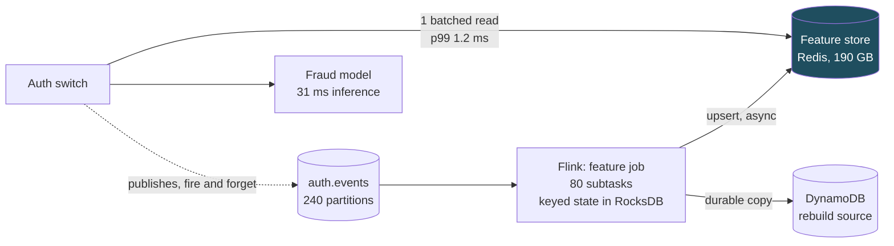

# Streaming Transforms, and the Feature Store That Keeps the Pipeline Out of the Request Path

This is the real-time tier. It exists to serve exactly one consumer well — the fraud model inside
the authorization decision — and the shape of the whole tier follows from one number established
in document 01:

```
authorization budget, p99.9                      150 ms
  of which the pipeline is allotted                8 ms
```

Eight milliseconds. Not eight milliseconds to compute something — eight milliseconds for a
network round trip and a lookup. Everything in this document is a consequence of that.

---

## What the fraud model actually needs, concretely

"Real-time fraud detection" is a phrase. Here is what sits behind it.

A fraudster has a stolen card number. The standard attack, called **card testing**, is to run a
sequence of small authorizations — $1.00, $0.98, $1.12 — across many merchants, to learn whether
the card is live before selling it or using it for a large purchase. A typical run is 200 to 600
authorizations over 15 to 25 minutes.

No single transaction in that run looks unusual. A $1.00 charge at an online merchant is the most
ordinary thing in the world. **The attack is only visible in aggregate**, and specifically in
aggregates over short windows:

| Feature | What it catches |
|---|---|
| Authorizations on this card in the last 60 seconds | Rapid-fire testing |
| Distinct merchants for this card in the last hour | A card being tried across a merchant list |
| Declines on this card in the last hour | Testing against a card that is already blocked |
| Distinct countries in the last 24 hours | Physically impossible travel |
| Ratio of this amount to the card's 30-day average | An unusually large charge after a quiet period |
| Authorizations at this merchant from distinct cards in the last 5 minutes | A compromised merchant terminal, or a fraudster's merchant |

Monarch's model consumes 47 features. Thirty-one of them are aggregates over a time window —
which is to say, thirty-one of them **cannot be computed from the authorization message alone.**
They require knowing what else happened recently.

That is the entire reason a streaming tier exists. Not because streaming is modern — because the
decision needs facts about the past, and the past must be summarised before the decision is
asked for.

---

## Three designs, two of which fail

### Attempt one: query the warehouse at decision time

The decision service runs a query against the warehouse: *count authorizations for this card in
the last 60 seconds.*

This fails three times over, and each failure is instructive.

**Latency.** A warehouse is built for scanning, not for point lookups. Even a well-tuned Snowflake
query with a clustered key returns in roughly 200 to 900 milliseconds. The budget is 8. It is not
close — it is off by two orders of magnitude.

**Load.** At 6,400 authorizations per second, this is 6,400 queries per second against the
warehouse, every one of them a separate statement. Warehouses price and scale on concurrency, and
this concurrency level is not a tuning problem.

**Freshness.** The warehouse is loaded on a schedule. Querying it for "the last 60 seconds"
returns whatever the last load contained, which is between 15 minutes and several hours old. The
query answers a question about the past that is not the question being asked.

This is exactly what Harbinger, Monarch's legacy system, does — 15-minute-stale features from
Teradata — and it is why a 20-minute card-testing run completes before any feature moves.

### Attempt two: compute the aggregate inside the request

Put the stream processor in the request path. The decision service asks Flink; Flink computes the
windowed count and answers.

This fails for a structural reason that is more important than latency: **it makes a pipeline
outage into a card network outage.** Flink restarts for checkpointing problems, for a task manager
losing a heartbeat, for a rescaling operation, for a deployment. Each of those is an ordinary,
expected occurrence for a streaming job and an unacceptable event for an authorization path. You
have taken
the least reliable component in the architecture and made it a hard dependency of the most
reliable one.

A useful sentence for the interview:

> I will not put a stream processor in a request path. A stream processor's availability profile
> is a batch system's — minutes of unavailability during recovery are normal and expected. The
> authorization path needs five nines. Those two things cannot be in series.

### What works: pre-compute, serve from a key-value store

The stream processor consumes `auth.events`, maintains the aggregates continuously, and **writes
the current value of every feature into a key-value store.** The decision service reads that store
and never knows the pipeline exists.



Notice the dotted line. The authorization switch *publishes into* the same stream whose output it
*reads from*, but the two paths are completely decoupled: the publish is asynchronous and
unacknowledged, the read is synchronous and fast. The loop closes in about 1.4 seconds under
normal conditions, and when it does not close, the read still succeeds — it just returns slightly
older values.

**That degradation behaviour is the property worth emphasising.** If the Flink job dies
completely, authorizations continue, using features frozen at the moment of death. The fraud
model gets worse, gradually, and someone is paged. Nothing stops. Compare that to attempt two,
where the same Flink failure stops the bank.

---

## The windowed-state problem, and how not to store a terabyte per window

Here is where naive streaming designs fall over.

A **sliding window** — "the count over the last 60 seconds, evaluated continuously" — is
conceptually what the feature needs. The naive implementation retains every event in the window
so that events can be removed as they age out. For a 24-hour window:

```
events in a 24-hour window, all cards  = 99,360,000
bytes retained per event (trimmed)     ≈ 90
state for one 24-hour feature          = 8.9 GB
```

That alone is survivable. But the model needs five windows (1 minute, 5 minutes, 1 hour, 24
hours, 7 days) across multiple aggregates, and the 7-day window is:

```
99,360,000 × 7 × 90 bytes = 62.6 GB, for one feature
```

Multiply by the 31 windowed features and you are storing several terabytes to answer questions
whose answers are each a single number. The naive approach stores the raw material forever
because it insists on exactness at every instant.

### Bucketed counters

The fix is to give up exactness at the boundary and store **pre-aggregated buckets** instead of
events. For the 24-hour window, keep 288 five-minute buckets per card. Each bucket holds a count
and a sum. Asking for "the last 24 hours" means summing 288 integers, which is free. Asking for
"the last hour" means summing the most recent 12.

What you lose: the window edge is now quantised to 5 minutes. "The last 24 hours" is really
"between 24 hours and 24 hours 5 minutes." For a fraud feature this is irrelevant — the model was
trained on the same quantisation, and no fraud signal turns on whether a window boundary is
precise to the second.

What you gain, derived:

```
Per card, per window granularity:
  1-minute window   → 60 buckets of 1 second
  5-minute window   → 60 buckets of 5 seconds
  1-hour window     → 60 buckets of 1 minute
  24-hour window    → 288 buckets of 5 minutes
  7-day window      → 168 buckets of 1 hour
                      ------
  total buckets                      596
  bytes per bucket (count + sum)      16
  counter state per card           9,536 bytes ≈ 9.3 KB
```

Plus the two cardinality features — distinct merchants and distinct countries — which use
**HyperLogLog sketches** rather than exact sets. A HyperLogLog is a fixed-size structure that
estimates distinct counts with about 2% error; Monarch uses 1,536 bytes per sketch. Two sketches:
3 KB.

```
total keyed state per active card ≈ 12.3 KB
```

Now, how many cards are active:

```
authorizations over 7 days = 99,360,000 × 7 = 695,520,000
distinct cards among them (measured)        = 52,000,000
keyed state total = 52,000,000 × 12.3 KB    = 639.6 GB
across 80 subtasks                          = 8.0 GB per subtask
```

Eight gigabytes of RocksDB state per subtask, on local NVMe. That is comfortable. Compare it to
the several terabytes the naive sliding window would have needed, and note that the entire saving
came from accepting a 5-minute quantisation nobody can perceive.

**The generalisable idea:** when a streaming aggregate's state is too large, the question to ask
is not "how do I store it more efficiently" but **"what exactness am I paying for that nobody
wants?"** Almost always the answer is boundary precision, and almost always it is free to give up.

---

## Event time, watermarks, and the two kinds of lateness

A transaction has two timestamps: when it happened (`event_time`, set by the terminal or the auth
server) and when the pipeline saw it (`ingest_time`, set by the gateway). Document 02 insisted
both be stamped. Here is why.

If you aggregate by `ingest_time` — "processing time" — then a network delay that holds records
for 90 seconds causes them to be counted in the wrong bucket, and a replay of historical data
produces completely different results from the original run. **A processing-time aggregate is not
reproducible**, which fails the compliance requirement in document 09 before you even get there.

So aggregate by `event_time`. Which immediately raises: how long do you wait for stragglers before
declaring a bucket closed?

That is what a **watermark** is. A watermark of "event time 14:32:10" is an assertion by the job:
*I believe I have seen all events with event_time at or before 14:32:10.* Buckets ending before
the watermark can be finalised.

Monarch's two sources have very different lateness profiles, and this is the practical point:

**Card-not-present transactions** — online purchases — arrive from the network within 200 to 900
milliseconds of occurring. Lateness beyond 3 seconds is rare.

**Card-present transactions from offline-capable terminals** are a different animal. A terminal on
a plane, a cruise ship, or a transit gate authorizes offline against locally stored limits and
submits the record when it reconnects. Monarch sees these **up to 72 hours late**, and sometimes
longer.

If you set the watermark to accommodate the worst case, every bucket waits 72 hours and the
feature store serves nothing useful. If you set it at 3 seconds, you discard the offline
transactions.

The resolution is to stop treating it as one pipeline:

- **The feature job uses a 5-second bounded-out-of-orderness watermark and drops later events into
  a side output.** Fraud features are about the immediate past; a transaction from two days ago
  has no bearing on whether this one is fraud, and incorporating it would retroactively change a
  decision that has already been made.
- **The side output goes to a topic that the lake writer consumes**, so the late transaction is
  fully and correctly present in the analytical record and in the ledger. Nothing is lost — it is
  routed.
- **The ledger path has no watermark at all**, because the ledger is not windowed. A posting
  arriving 72 hours late is posted with its correct effective date, and the account's historical
  balances are recomputed. That is normal accounting behaviour, not an anomaly.

This is one of the strongest things you can say in this interview, because it demonstrates that
you know lateness is not a single system-wide parameter:

> Lateness tolerance is a per-consumer decision, not a pipeline setting. The fraud features drop
> anything older than 5 seconds because an old event cannot inform a decision already made. The
> ledger accepts a 72-hour-late posting without complaint because accounting has always worked
> with effective dates. Same event, two correct and opposite treatments.

---

## Delivery guarantees: where exactly-once is worth paying for

Flink offers exactly-once processing semantics through checkpointing — periodically snapshotting
all keyed state and the input offsets together, so that a restart resumes from a consistent point
with no double-counting.

The cost is real: checkpoints pause or slow processing, they write hundreds of gigabytes of state
to S3, and checkpoint failures under load are a common operational problem.

**For the feature job, Monarch uses at-least-once, not exactly-once.** The reasoning is worth
following, because it is the opposite of what people assume for anything touching fraud:

A feature-store write is an **upsert of a current value**: "card `tok_7f3a` now has 14
authorizations in its 5-minute bucket ending 14:35." Applying that write twice produces the same
result as applying it once — it is *idempotent*. Duplicate delivery therefore cannot corrupt the
feature store. What a restart can do is briefly serve slightly stale values while the job catches
up, which is a freshness issue, not a correctness one.

Exactly-once would buy nothing and cost checkpoint overhead on the most latency-sensitive job in
the system. Monarch checkpoints every 30 seconds in at-least-once mode, which gives a worst-case
replay of 30 seconds of events after a failure — and because the writes are idempotent, replaying
them is harmless.

**For the ledger job, exactly-once is non-negotiable**, and the mechanism is different: the
posting write is *not* idempotent in itself, because "credit account X by $47.12" applied twice
credits $94.24. Document 08 is about how that path is made safe, which turns out to rely on
idempotency keys in the ledger store rather than on Flink's exactly-once mode.

The general rule, which is the thing to actually remember:

> **Exactly-once processing is a way to make non-idempotent writes safe. If you can make the write
> idempotent instead, do that — it is cheaper, simpler, and survives a wider range of failures.**
> Reach for exactly-once when the write genuinely cannot be made idempotent.

---

## The feature store itself: choosing, and the 8 milliseconds

The store holds, per card and per account, the current value of every feature. Sizing:

```
features per card, serialized                   ≈ 1,800 bytes
active cards (7-day)                              52,000,000
                                                  ------------
card-level data                                 = 93.6 GB
account-level and merchant-level features       ≈ 96 GB
                                                  ------------
total working set                               ≈ 190 GB
```

Write rate at peak: one upsert per authorization, 6,400/second. Read rate: one batched read per
authorization — and *batched* is load-bearing. The model needs card features, account features,
and merchant features. Three separate round trips at 1.2 ms each is 3.6 ms of the 8 ms budget
spent on network. One multi-key read is 1.2 ms. **Batch the read or lose half the budget to
round trips.**

The two candidates:

**DynamoDB.** Durable, managed, scales without operational attention, and its single-digit
millisecond latency claim is real for the median. The p99, under mixed load, in Monarch's own
measurements, ran 9 to 14 milliseconds — which exceeds the entire allocation. DynamoDB
Accelerator would fix the read latency but adds a cache whose consistency behaviour has to be
reasoned about.

**ElastiCache for Redis, cluster mode.** In-memory, p99 read measured at 1.2 ms for a multi-key
read within one slot. Not durable in the sense a database is, and a 190 GB in-memory footprint is
genuinely expensive.

**Monarch uses Redis for serving and DynamoDB as the durable copy, with Flink writing both.**
The reasoning:

- Redis meets the latency requirement with room to spare; DynamoDB does not.
- The durability objection to Redis is weak *here specifically*, because the feature store is a
  materialisation and is rebuildable. If the whole Redis cluster is lost, the features are
  recomputed from the last 7 days of `auth.events` — and because broker plus tiered retention is
  30 days, that data is available. Measured rebuild time: **21 minutes** at full parallelism.
- The DynamoDB copy exists so that the rebuild is usually unnecessary: a single lost Redis shard
  is repopulated from DynamoDB in under two minutes rather than by replaying Kafka.

The honest trade-off to state out loud: this is two stores to keep consistent, and they can drift.
Monarch accepts that because Redis is authoritative for serving and DynamoDB is only ever read
during recovery, so drift between them affects recovery quality, not decisions. **Naming which
store is authoritative for which purpose is what makes a two-store design defensible rather than
sloppy.**

---

## The failure mode nobody mentions: training-serving skew

This is the question that separates candidates who have deployed a model from those who have
read about it, and it comes up at a bank because model governance makes it a regulatory matter
rather than only an accuracy matter.

The model was trained on historical data — a table of transactions with their features and
whether they turned out to be fraud. At serving time it reads features from Redis. If those two
feature computations differ in any way, the model performs worse in production than in testing,
and nobody can explain why.

They differ in ways that are easy to create and hard to find:

**Different code paths.** The training features were computed by a SQL query over the lake; the
serving features by Flink. Two implementations of "distinct merchants in the last hour" written
by two teams in two languages will disagree at the edges — on timezone handling, on whether the
window is inclusive, on how declines are counted.

**Label leakage through time.** The training query computed "authorizations in the last hour" with
a `WHERE event_time BETWEEN ...` that, because of how the join was written, included transactions
from *after* the one being scored. The model learned to use information that does not exist at
decision time. It tests beautifully and fails in production. This is the most common serious bug
in fraud modelling and it is invisible in offline evaluation.

Monarch's two mitigations:

**One definition, two execution engines.** Features are defined once in a declarative
specification — window, aggregate, filter, source field — and both the Flink job and the training
query are generated from it. Not "documented in the same place" — *generated*, so that a change
cannot apply to one and not the other.

**Log the features that were actually used, with the decision.** Every record in
`risk.decisions.v1` carries the exact feature vector that was read from Redis, the model version,
and the feature-definition version. This does three things at once:

- Training sets are built from logged serving features rather than recomputed from history, which
  eliminates skew by construction. The model trains on exactly what it will see.
- Point-in-time correctness is automatic, because the logged vector is by definition what was
  known at decision time. Leakage becomes impossible rather than merely discouraged.
- When a regulator asks why a particular transaction was declined in March 2024, the answer is one
  row: these 47 feature values, this model version, this score, this threshold. Document 09 leans
  on this heavily.

This is also why `risk.decisions.v1` records are 900 bytes rather than 200. The feature vector is
most of it. **It is worth every byte**, and the 7-year retention on that topic — 33.5 TB, about
$160 a month — is the cheapest regulatory insurance in the architecture.

---

## Rescaling, which is the operational cost of keyed state

A stateless job scales by adding workers. A job holding 640 GB of keyed state does not.

When Flink parallelism changes from 80 to 120, every key must be reassigned, which means state
must be redistributed. Flink handles this through **key groups** — a fixed number of logical
buckets, assigned to subtasks, so rescaling moves whole buckets rather than individual keys. The
key group count is set at job creation and **caps maximum parallelism permanently.**

Monarch sets `maxParallelism` to 1,024. The consequences:

- Any parallelism up to 1,024 is reachable without rebuilding state from scratch.
- Key groups per subtask at 80-way parallelism: 1,024 / 80 = 12.8 — which does not divide evenly,
  so some subtasks get 13 key groups and some get 12, an 8% imbalance. At 128-way it is exactly 8
  each. **Choosing parallelism as a divisor of maxParallelism is free and skipping it costs a
  permanent imbalance**, which is the same divisibility argument as partition counts in document
  03.
- Rescaling requires a **savepoint** — a full, portable snapshot of state. For 640 GB to S3 this
  takes about 11 minutes to write and 14 minutes to restore, during which the job is not
  processing. So a rescale is a 25-minute freshness gap, which is fine for the feature job
  (features go stale, decisions continue) and would be catastrophic for anything in a request
  path. Another reason the pipeline is not in the request path.

Set `maxParallelism` generously on day one. It is free to set high and impossible to raise later
without a state rebuild.

---

## What to take away

1. **Thirty-one of the model's 47 features are windowed aggregates**, which is the entire reason a
   streaming tier exists — the decision needs facts about the recent past, summarised before the
   question is asked.
2. **Never put the warehouse or the stream processor in the request path.** The warehouse is 200–900
   ms where the budget is 8; the stream processor has a batch system's availability profile and
   would make a routine Flink restart into a card-network outage.
3. **Pre-compute into a key-value store and let the decision read it.** When the job dies,
   features freeze and decisions continue getting gradually worse — degradation rather than
   outage.
4. **Replace sliding windows with bucketed counters.** 596 buckets per card at 16 bytes is 9.3 KB;
   with two HyperLogLog sketches, 12.3 KB per card, 640 GB total, 8 GB per subtask. The naive
   event-retaining window would have been terabytes, and the entire saving comes from accepting a
   5-minute boundary quantisation nobody can perceive.
5. **Aggregate by event time, never processing time**, or your aggregates are not reproducible and
   a replay gives different answers than the original run.
6. **Lateness tolerance is per-consumer.** Fraud features drop anything over 5 seconds because an
   old event cannot change a decision already made; the ledger accepts 72-hour-late offline
   terminal records and posts them with their effective date. Route late events to a side output
   rather than discarding them.
7. **Use at-least-once for the feature job, because feature writes are idempotent upserts.**
   Exactly-once is a technique for making non-idempotent writes safe — if you can make the write
   idempotent instead, that is cheaper and more robust.
8. **Redis for serving at 1.2 ms p99, DynamoDB as the durable copy**, with Redis authoritative for
   reads and DynamoDB read only during recovery. The durability objection to Redis is weak because
   the store is rebuildable from Kafka in 21 minutes.
9. **Batch the feature read.** Three sequential reads at 1.2 ms each consume 45% of the 8 ms
   budget in network time alone.
10. **Log the exact feature vector with every decision.** It eliminates training-serving skew by
    construction, makes time leakage impossible, and turns "why was this declined in March 2024"
    into a single-row answer — at a cost of about $160 a month.
11. **Set `maxParallelism` generously on day one** (Monarch uses 1,024); it permanently caps
    scaling and cannot be raised without rebuilding state, and choosing a parallelism that divides
    it evenly avoids a permanent subtask imbalance.
