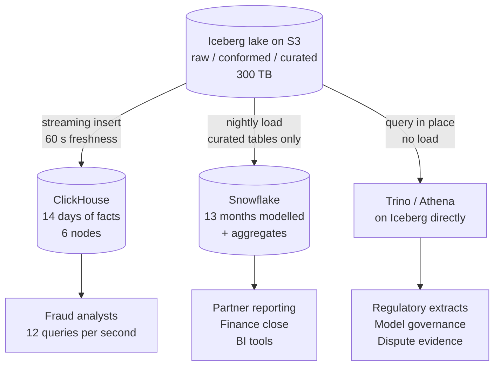

# The Serving Layer: Three Query Shapes, and Why One Engine Does Not Serve All Three

The question's outline names three use cases — risk dashboards, merchant reporting, compliance
audits — and implies they all read from the warehouse. This document is about why they want
genuinely different things from a query engine, and what it costs to pretend otherwise.

The claim this document argues:

> These three consumers differ in concurrency by a factor of 100, in latency requirement by a
> factor of 300, and in data volume per query by a factor of 2,500. An engine tuned for one is
> badly suited to another, and the cost of forcing them together is paid in either money or
> incident reports.

---

## The three shapes, measured

### Shape one: the analyst risk dashboard

A fraud analyst watching an attack in progress has a dashboard of nine panels: authorization
volume by minute, decline rate by minute, top merchants by decline rate, geographic distribution,
the rule-hit mix, and so on. The panels refresh every 30 seconds while the analyst watches.

Monarch has 140 fraud analysts. Most of the time perhaps 15 are looking at dashboards. During an
active attack — which is exactly when the system must not be slow — that goes to 40.

```
concurrent analysts during an attack      40
panels per dashboard                       9
refresh interval                          30 s
                                       --------
sustained query rate = 40 × 9 / 30   =  12 queries per second
```

Each query scans the last 1 to 48 hours of authorizations. A 24-hour scan is 99.4 million rows,
filtered and grouped. And the latency requirement is behavioural rather than contractual: **above
about 2 seconds, analysts stop using the dashboard and ask an engineer to run a query instead**,
which is both slower and a worse use of two people.

So: 12 queries per second, each aggregating up to 100 million rows, each returning in under 2
seconds, with data no more than 60 seconds old.

### Shape two: merchant and partner reporting

Two co-brand partners receive a daily file by 06:00 ET: transaction counts, approved volume,
decline reasons, broken out by store and merchant category. Internally, the merchant analytics
team runs a similar set of aggregations across all 410,000 merchants seen in the month.

```
queries per day                      ~90 (the daily batch, plus ad-hoc)
rows scanned per query               99.4 M to 3 B (a full month)
latency requirement                  the whole batch must finish in a 4-hour window
concurrency                          1 to 3
freshness                            T+1, complete
```

Twelve queries per second versus ninety queries per *day*. Three orders of magnitude apart in
concurrency, and the reporting queries are each 30 times larger.

### Shape three: the regulatory extract

A Bank Secrecy Act examination asks for every transaction above a threshold, for a set of
accounts, over three years, with the risk decision and the features that produced it. A dispute
under Regulation E asks for everything about one account for 90 days. A model-governance review
asks for the full scored population of a quarter.

```
queries per year                     maybe 200
rows scanned per query               up to 250 B (seven years of several streams)
latency requirement                  none — days is acceptable
concurrency                          1
freshness                            irrelevant
reproducibility                      absolute: the same query with the same as-of date must
                                     return byte-identical results in five years
```

The requirement that constrains the design is the last one, and no warehouse feature provides it
by itself.

### Side by side

| | Risk dashboard | Partner reporting | Regulatory extract |
|---|---|---|---|
| Queries per second | 12 | 0.001 | 0.000006 |
| Rows per query | 100 M | 100 M – 3 B | up to 250 B |
| Latency budget | 2 s | 4 hours | days |
| Freshness | 60 s | T+1 | irrelevant |
| Dominant cost driver | Concurrency | Scan volume | Nothing — it is rare |
| What failure looks like | Analysts stop using it | A partner escalates | A regulatory finding |

**Concurrency and scan volume are the two axes, and they trade off against each other in every
engine ever built.** An engine that holds data in a layout optimised for fast point-in-time
aggregation at high concurrency is holding it in a layout that is not optimal for a 3-billion-row
scan, and vice versa.

---

## What happens if you serve all three from Snowflake

Worth working through, because "just use the warehouse for everything" is the default answer and
it fails in a specific, measurable way rather than a vague one.

Snowflake serves concurrency by running multiple clusters behind one virtual warehouse. A query
is assigned to a cluster; when clusters are saturated, queries queue. So the dashboard load
requires enough clusters to keep 12 queries per second flowing with sub-2-second latency.

A 100-million-row aggregation on a Medium warehouse takes roughly 3 to 6 seconds cold, perhaps
1.5 seconds with the result cache warm. But a dashboard refreshing every 30 seconds against data
that changes every second **never hits the result cache** — the data has changed, so the cached
result is invalid. Every refresh is a real query.

```
sustained queries                       12 per second
mean query duration (Medium, warm data)  ~2.5 s
concurrent queries in flight             12 × 2.5 = 30
queries per cluster before queueing      ~8
clusters required                        30 / 8 = 4
```

Four Medium clusters, running whenever analysts are working. Medium is 4 credits per hour:

```
4 clusters × 4 credits/hour × 10 hours/day × 22 working days = 3,520 credits/month
at $3.00 per credit (Enterprise)                              = $10,560/month
```

**About $127,000 a year to serve dashboards to 40 analysts**, and that is before the reporting
and extract workloads, which will contend with the dashboards for the same resources unless they
get their own warehouse — at which point you are already running separate engines, just all from
one vendor and all at warehouse prices.

There is also a non-cost failure. The reporting batch at 04:00 and a dashboard query at 04:00
compete. Give them one warehouse and an attack at 04:00 means analysts wait behind a
3-billion-row scan. Give them separate warehouses and you have accepted that these are separate
systems.

A columnar analytical database built for exactly this shape — ClickHouse, Druid, or Pinot —
serves the same 12 queries per second from a much smaller footprint, because it is doing less:
it holds only recent data, in a fixed layout, with pre-sorted primary keys and no need to support
arbitrary joins or transactional semantics.

```
ClickHouse cluster: 6 × r6g.4xlarge (16 vCPU, 128 GB)
holding 14 days of fact_authorization, pre-sorted
on-demand, reserved 1-year: ~$0.61/hour each
6 × $0.61 × 730 hours = $2,672/month
```

**$32,000 a year instead of $127,000**, for better latency, with the reporting workload no longer
able to interfere. The cost is one more system to operate, which is a real cost and should be
named as such — but at a 4× difference, with an isolation benefit attached, it is the right
trade.

---

## The three-store answer



**ClickHouse holds 14 days** of `fact_authorization` and the rule-hit summary, fed by a streaming
insert from the same Flink topology as the feature store. Fourteen days because that covers every
dashboard time range an analyst uses; anything longer is a reporting question. Sizing:

```
14 days × 99.4 M authorizations = 1.39 B rows
bytes per row in ClickHouse (sorted, compressed) ≈ 180
                                                  --------
                                                  250 GB
```

250 GB across six nodes with 128 GB of RAM each: the hot few days sit in page cache, which is
where the sub-second latency comes from.

**Snowflake holds 13 months** of modelled, curated tables — not raw events. Partner reporting,
finance close, and the BI tools point here. Thirteen months because year-over-year comparison is
the longest range these consumers ask for, and because the stored volume drops enormously when
you hold curated aggregates rather than raw facts:

```
curated.merchant_daily: ~1.2 M rows/day × 200 bytes  = 240 MB/day
curated.account_monthly: 62 M rows/month × 340 bytes = 21 GB/month
fact_authorization (13 months, kept for drill-down)  = 8.9 TB
other curated tables                                 ≈ 1.4 TB
                                                       --------
Snowflake storage                                    ≈ 10.4 TB  → $239/month
```

Ten terabytes instead of three hundred, because the warehouse holds what warehouse consumers
query and the lake holds everything else.

**Trino or Athena queries Iceberg directly** for the regulatory shape. No load step at all. This
is the right answer for a workload that runs 200 times a year over seven years of history: paying
to load 300 TB into a warehouse so that 200 queries a year can run faster is not a trade worth
making, and — more importantly — querying the lake directly is what makes reproducibility
achievable, because the snapshot you query *is* the archived record rather than a copy of it.

---

## Dimensional modelling, and the question about grain

The warehouse layer is modelled dimensionally, and the first question to answer out loud is the
**grain** of the fact table: what exactly does one row represent?

For `fact_authorization` the grain is **one row per authorization request**, including declines.
That phrasing contains two decisions:

**Declines are rows, not an absence of rows.** A design that stores only approvals cannot answer
"what is our decline rate by merchant category," which is one of the most-asked questions at an
issuer, and cannot support fair-lending analysis at all. Declines are 6.26 million rows a day and
they are the more interesting 6%.

**One row per *request*, not per *transaction lifecycle*.** A single purchase can involve an
authorization, a reversal, a partial capture, and a refund. Collapsing those into one row makes
the grain "a transaction," which sounds cleaner and destroys the ability to analyse timing between
stages — and timing between stages is where several fraud patterns live. The lifecycle is modelled
as a separate `fact_transaction_lifecycle` table that references the authorization rows.

Getting the grain wrong is the most expensive modelling mistake available, because every
aggregation built on top of a fact table inherits its grain, and changing it later means rebuilding
every downstream table and re-validating every report.

### Slowly changing dimensions, which is where "as of" correctness comes from

A merchant's category code changes. A customer's credit limit is raised. An account moves from
"current" to "delinquent."

The naive dimension table holds current values and overwrites on change. Then a report on March
2024 transactions, run today, joins to *today's* merchant categories — and the March report
produced in April does not match the March report produced in November. Two reports of the same
period disagree, both are "correct," and nobody can explain it to a partner.

The fix is a **type 2 slowly changing dimension**: rather than overwriting, insert a new row and
close the old one.

```
dim_merchant
  merchant_key   merchant_id   mcc    name              valid_from    valid_to      is_current
  881043         MRC-40192     5812   Ridgeline Cafe    2019-04-02    2024-02-17    false
  992217         MRC-40192     5814   Ridgeline Cafe    2024-02-17    9999-12-31    true
```

`merchant_key` is a **surrogate key** — an identifier for *this version of this merchant*, not for
the merchant. The fact row stores `merchant_key`, chosen at load time by looking up which version
was valid at the authorization's `event_time`. A March 2024 transaction permanently points at
`881043` with MCC 5812, so the March report returns the same numbers forever.

The two things to be able to say about this:

**It is the only way to make historical reports stable**, and historical report stability is not a
nice-to-have at a bank — it is how you avoid explaining to a co-brand partner why the number you
sent in April differs from the number you are showing in November.

**It must be combined with the lake's snapshot capability, not substituted for it.** The type 2
dimension preserves what the *attribute* was. The Iceberg snapshot preserves what the *record*
was, including rows later found to be wrong. A regulator asking "what did you know on 3 March"
needs both: the attribute values in force then, and the set of facts that existed then. Document
09 goes into this.

---

## Pre-aggregation: what to materialise and what to leave

The partner reporting query — transaction counts and volumes by merchant, category, response
code, and day — is run roughly 90 times a day against the same underlying data. Running it live
each time means 90 scans of 99 million rows.

Materialising it:

```
grain: (business_date, merchant_id, mcc, response_code, card_present)
distinct combinations per day (measured)      ≈ 1.2 M rows
bytes per row                                   200
                                               -------
curated.merchant_daily                        = 240 MB/day
7 years                                       = 613 GB
```

A query against a 240 MB daily table instead of a 20.5 GB daily fact table is roughly 85 times
less work, and it is computed once per day rather than 90 times.

**What not to materialise**, which is the harder half of the decision. Monarch's rule:

> Materialise an aggregate when the query is run more often than the data changes, and when the
> grain is stable. Do not materialise when consumers need to slice by a dimension you did not
> include, because then they query the fact table anyway and you are maintaining a table nobody
> uses.

The failure mode here is an accumulation of 40 aggregate tables, each built for one dashboard,
each needing to be backfilled when the fact table is reprocessed, each a separate thing that can
silently stop refreshing. Monarch keeps eleven. The discipline is that **every materialised
aggregate must have a named owner and a named consumer**, and one with no consumer is dropped at
the quarterly review. Aggregates are cheap to create and expensive to keep.

---

## The dashboard freshness path

Recall the 60-second SLO. The path that delivers it:

```
auth occurs
  → published to Kafka                               ~1.1 s (ring buffer drain)
  → Flink reads, conforms, enriches                  ~0.8 s
  → batched insert into ClickHouse (5 s batches)     ~3.0 s average
  → visible to query                                 ~0.2 s (part becomes queryable)
                                                     --------
  total, typical                                     ~5.1 s
  total, p99                                        ~14 s
```

Comfortably inside 60 seconds, with headroom for a Flink restart. Three notes:

**This feed has no watermark, unlike the feature job.** Document 04's feature job drops anything
more than 5 seconds late, because an old event cannot inform a decision already made. The
ClickHouse feed is appending facts rather than closing windows, so it accepts a late arrival
whenever it turns up and inserts it under its original `event_time`. The consequence to be aware
of: a dashboard query over a past day can return a larger number today than it did yesterday,
because an offline-terminal transaction arrived in between. That is correct behaviour, and it is
also the most common reason a dashboard and a report appear to disagree.

**Insert batching is mandatory.** ClickHouse performs poorly with many small inserts — each
creates a part, and parts must be merged in the background. Monarch inserts every 5 seconds or
every 100,000 rows, whichever comes first, which produces about 17,000 parts a day per table
before merging. Inserting per row would produce 99 million parts and the cluster would spend all
its time merging. This is structurally the same problem as the small files in document 05, at a
different layer, and it has the same fix: batch the writes, merge in the background, monitor the
merge backlog.

**Fourteen days of retention means a deletion job.** ClickHouse's TTL handles it declaratively,
and the thing to verify is that dropping a partition actually reclaims disk rather than marking
rows. A dashboard store that silently grows past its disk is a Saturday morning problem.

---

## What to take away

1. **The three consumers differ by 100× in concurrency, 300× in latency requirement, and 2,500× in
   rows per query.** Concurrency and scan volume trade off in every engine, so one engine cannot
   be optimal for all three.
2. **The dashboard workload is 12 queries per second** — 40 analysts × 9 panels ÷ 30-second
   refresh — each aggregating up to 100 million rows in under 2 seconds, and it never hits a
   result cache because the data changes every second.
3. **Serving dashboards from Snowflake needs four Medium clusters, about $127,000 a year**, and
   puts analysts in a queue behind the reporting batch during an attack. A purpose-built columnar
   store does it for about $32,000 with better latency and real isolation.
4. **Three stores: ClickHouse for 14 days of facts at high concurrency, Snowflake for 13 months of
   curated tables, Trino on Iceberg for the rare full-history regulatory query.** The warehouse
   holds 10.4 TB, not 300 TB, because it holds only what warehouse consumers query.
5. **Query the lake directly for the regulatory shape.** Two hundred queries a year do not justify
   loading 300 TB, and querying the archived snapshot *is* the reproducibility mechanism rather
   than a copy of it.
6. **State the fact table's grain explicitly: one row per authorization request, declines
   included.** Declines are 6% of rows and the more interesting 6%; collapsing the transaction
   lifecycle into one row destroys inter-stage timing analysis.
7. **Type 2 slowly changing dimensions are the only way historical reports stay stable.** The fact
   row stores a surrogate key for the dimension version in force at `event_time`, so the March
   report returns identical numbers in April and in November.
8. **Type 2 dimensions and Iceberg snapshots solve different halves of the same problem** — what
   an attribute was, versus what the set of facts was — and a regulatory answer needs both.
9. **Materialise an aggregate when it is queried more often than the data changes and the grain is
   stable.** Require a named owner and a named consumer, and drop the ones with neither;
   aggregates are cheap to create and expensive to keep.
10. **Batch inserts into the dashboard store.** It is the small-file problem from document 05
    reappearing at a different layer, with the same fix and the same monitoring requirement.
