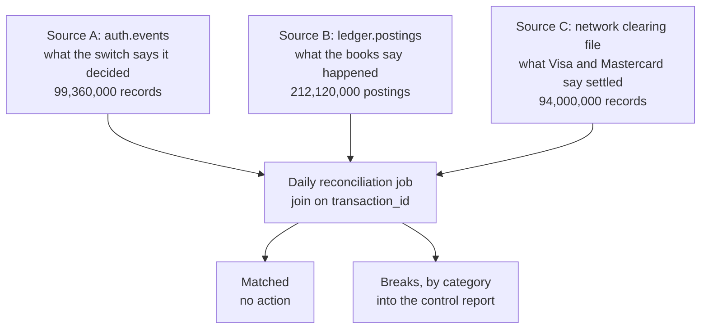

# Correctness: Duplicates, the Ledger, and the Three-Way Reconciliation That Proves It Works

Everything up to here has been about moving data and serving it. This document is about the
question a bank asks that a product company usually does not:

> **How do you know the pipeline is right?**

Not "how do you know it is running" — the lag dashboards answer that. How do you know that the
99,360,000 authorizations that occurred yesterday are 99,360,000 rows in the lake, with the
correct amounts, each counted exactly once, and that the 212,120,000 ledger postings derived from
them sum to the right balances.

The reason this gets its own document is the asymmetry established in document 00: **the cheap
failure is loud and immediate; the expensive one is silent.** A pipeline that stops is noticed in
minutes. A pipeline that drops 0.03% of records, or double-counts a category of reversal,
produces green dashboards and a number that is wrong until a counterparty or an examiner finds
it.

---

## Where duplicates come from, which is more places than you expect

You cannot reason about exactly-once without knowing the actual sources of duplication in this
system. There are five, and they occur at different layers.

**1. The card network retransmits.** If an acquirer does not receive Monarch's authorization
response within its timeout, it resends the same request. Monarch sees two identical
authorization requests for one purchase. This happens roughly 0.08% of the time — about 79,000
times a day — and it happens *before* any of your infrastructure is involved.

**2. The producer retries.** A Kafka producer that does not receive an acknowledgement resends.
With `enable.idempotence=true` the broker deduplicates these within a producer session, but across
a producer restart the sequence numbers reset and a record in flight at restart can be written
twice.

**3. The consumer restarts.** A consumer that processed records and crashed before committing its
offset reprocesses them on restart. This is the ordinary, expected behaviour of at-least-once
delivery and it happens every time a job is deployed.

**4. The file is redelivered.** SFTP retries, or an operator re-runs an ingest after a failure.
Document 02 handles this with checksum-based idempotency, but only if the checksum table is
actually consulted.

**5. A human re-runs a job.** The most common source, and the one with the fewest safeguards.
Someone reruns yesterday's batch because the first run looked wrong, and both runs' output lands.

The important observation: **these happen at five different layers, so there is no single place to
deduplicate.** The design has to handle duplication at the boundary where it can be detected, and
that means knowing what makes two records "the same."

---

## The identity problem: what makes two authorizations the same transaction

This is the detail that separates someone who has worked on payments from someone who has not,
and it is worth knowing precisely.

The instinct is to use an identifier the system generates. That fails for source 1 — the network
retransmission — because Monarch's auth server generates a fresh identifier for each inbound
message, so a retransmitted purchase gets two.

So the identity must be derived from fields the *network* provides, which are stable across a
retransmission. In ISO 8583 the candidates are:

- **STAN** (System Trace Audit Number, field 11) — a 6-digit counter, unique per acquirer per day.
  Six digits means it wraps at 999,999, which a large acquirer exhausts in hours.
- **RRN** (Retrieval Reference Number, field 37) — 12 characters, intended to be unique per
  acquirer for a reasonable period. In practice, acquirer implementations vary and duplicates
  within a day do occur.
- **Terminal ID and merchant ID** (fields 41, 42).
- **Transmission date and time** (field 7), **local transaction date and time** (fields 12, 13).
- **Amount** (field 4).

**No single field is reliably unique.** Monarch's transaction identity is a composite:

```
transaction_id = hash(
    acquirer_bin,        -- who sent it
    rrn,                 -- the acquirer's reference
    stan,                -- the trace number
    terminal_id,         -- which terminal
    local_txn_date,      -- the merchant's local date
    amount_minor,        -- the amount in cents
    pan_token            -- which card
)
```

Seven fields. The redundancy is deliberate: any one of them being unreliable in a particular
acquirer's implementation does not break identity, because the others still differentiate.

Two consequences worth stating:

**This identity is computed at the ingest gateway and travels on every derived record.** The
risk decision, the ledger postings, the clearing record when it arrives — all carry the same
`transaction_id`. That is what makes the three-way reconciliation later in this document a join
rather than a fuzzy match.

**It is a hash of business fields, not a UUID**, so it is reproducible. If you need to recompute
it during a reprocess, you get the same value. A UUID generated at ingest would be stable but
unreproducible, which means a reprocessed record would not match its own ledger postings.

---

## Deduplicating in the stream

With a reliable identity, deduplication is a keyed-state operation: hold the set of
`transaction_id` values seen, drop anything already present.

The design question is **how long to hold them**, because the state is not free:

```
authorizations per day                     99,360,000
bytes per dedup entry (hash + timestamp)           40
state for 24 hours                         3.97 GB
state for 48 hours                         7.95 GB
across 80 subtasks, at 48 hours            99 MB per subtask
```

Monarch holds 48 hours. The reasoning:

- Network retransmissions arrive within seconds, so 48 hours is enormous overkill for source 1.
- Consumer restarts replay at most the checkpoint interval, 30 seconds. Also covered trivially.
- **The case that sets the window is the human re-run.** Someone re-running yesterday's ingest is
  the realistic 24-hour-plus duplication event, and 48 hours covers "yesterday, plus the morning
  someone noticed."
- Beyond 48 hours, deduplication moves to the batch layer, where it is a `GROUP BY transaction_id`
  over an immutable partition — cheap, exact, and not dependent on any retained state.

That last point is the structural answer: **streaming deduplication covers a bounded recent
window, and the batch layer provides exactness over everything older.** Trying to make the
streaming job the sole deduplication authority means unbounded state and a correctness guarantee
that depends on a job never losing its state, which is not a guarantee you want to depend on.

---

## The ledger, where the correctness bar is highest

The feature store tolerates duplicates because its writes are idempotent upserts (document 04).
The ledger does not, because "credit account X by $47.12" applied twice credits $94.24.

Three mechanisms, layered, because any one of them can fail.

### Mechanism one: the posting is written with an idempotency key

Each posting carries a deterministic key:

```
posting_id = hash(transaction_id, posting_sequence, account_id, direction)
```

and the ledger table has a unique constraint on it. A duplicate insert fails at the database,
loudly, rather than succeeding and corrupting a balance. The consumer catches the constraint
violation, treats it as success, and commits its offset.

**This is what makes at-least-once delivery safe for the ledger** — not Flink's exactly-once mode.
The guarantee lives in the sink, where it can be enforced by a constraint, rather than in the
processing framework, where it depends on checkpoint integrity.

### Mechanism two: postings are written in balanced groups

Double-entry means every economic event produces postings summing to zero. Monarch enforces this
at write time: postings are submitted as a **batch with a declared sum**, and the ledger rejects
any batch whose postings do not sum to zero.

```
transaction 8f3a91: authorize $47.12 on account 88241063
  posting 1   account 88241063 (customer receivable)      +4712
  posting 2   account 20100 (card settlement clearing)     -4712
                                                          ------
  sum                                                          0   → accepted
```

The value of this is that it catches an entire class of logic bug at the moment of writing rather
than at the month-end close. A transform that computes a fee incorrectly produces an unbalanced
batch and is rejected; a transform that applies a posting to the wrong account but keeps it
balanced is not caught here, which is what mechanism three is for.

### Mechanism three: the balance is derived, never stored as a mutable value

The account balance is not a column that gets updated. It is the sum of postings, materialised as
a **daily closing balance** per account plus the postings since. Computing a current balance is:

```
closing_balance(account, yesterday) + SUM(postings since midnight)
```

This matters because a stored mutable balance can drift from its postings and nothing notices. A
derived balance cannot drift — it either equals the sum of postings or the arithmetic is wrong,
which is checkable. Monarch recomputes every account's closing balance nightly from the full
posting history for a rotating 1/30th of accounts, which means every account's entire history is
re-verified monthly:

```
accounts verified per night = 62,000,000 / 30 = 2,066,667
postings per account over 7 years ≈ 2,460
rows summed per night = 5.08 billion
cost on Spark at 35 GB/node-hour over ~340 GB = 9.7 node-hours ≈ $1.50
```

**A dollar fifty a night to re-derive a thirtieth of the bank's balances from first principles.**
When a discrepancy is found — and over five years Monarch has found four, all from code bugs
rather than data loss — it is found by this job, in a day, rather than by a customer.

---

## Three-way reconciliation: the thing that actually proves the pipeline works

Everything so far is internal consistency: the pipeline agreeing with itself. Internal consistency
is necessary and not sufficient, because a systematic bug is internally consistent. If the
gateway drops every transaction with a particular currency code, every downstream store agrees
perfectly about a set of transactions that is missing 0.3% of its members.

**The only thing that detects systematic loss is comparison against a party that did not share your
bug.** At a card issuer that party is the network, and the artefact is the daily clearing file.



Three sources, three pairwise comparisons, and each comparison detects a different failure.

### A versus B: did every authorization produce correct postings?

Join approvals in `auth.events` to `ledger.postings` on `transaction_id`.

```
approvals yesterday                           93,100,000
approvals with exactly 2 postings              93,099,961
approvals with 0 postings                              39   ← investigate
approvals with other than 2 postings                    0
postings with no matching approval                      0
```

The expected result is exact equality, and the threshold is **zero**. Not 0.01% — zero. Every
approval must produce postings, because an approval with no posting is a charge the customer will
see on a statement that the general ledger does not know about.

Thirty-nine missing is an incident, and the response is not to backfill them quietly: it is to
determine why 39 records took a path that lost them, because the mechanism that lost 39 today can
lose 39,000 tomorrow.

### A versus C: did the pipeline capture every transaction that actually happened?

This is the one that detects data loss at the edge — the ring-buffer overflow from document 02,
a broker outage, a gateway rejecting records it should have accepted.

Join clearing records to authorizations. Here, unlike A versus B, the expected result is **not**
equality, and knowing why is the substance of the answer:

| Category | Expected rate | Why |
|---|---|---|
| Clearing record matches an approval | ~99.6% | The normal case |
| Clearing record with no matching authorization | 0.3–0.5% | **Forced posts**: offline terminals, merchant floor-limit transactions, and card-present transactions authorized by the network's stand-in. These were never seen by Monarch's switch, legitimately |
| Approval with no clearing record within 5 days | 6.5–7.1% | **Auth-only transactions**: hotel and car-rental holds, cancelled e-commerce orders, gas-pump pre-authorizations that clear at a different amount under a different reference |
| Clearing amount differs from authorized amount | 10.5–11.5% | Tips, partial shipments, currency conversion, fuel pumps |

**Those are not errors. They are the normal physics of card payments**, and a reconciliation
design that treats them as breaks generates ten million exceptions a day and gets switched off
within a week.

The reconciliation's job is to classify each difference into an expected category with an expected
rate, and alert when a *rate* moves rather than when a difference exists:

```
yesterday's unmatched clearing rate     0.41%     (band: 0.30–0.50)   OK
yesterday's uncleared approval rate     6.82%     (band: 6.50–7.10)   OK
yesterday's amount-mismatch rate       11.04%     (band: 10.5–11.5)   OK
```

This is the real skill in reconciliation, and it generalises well beyond payments: **the signal is
not the existence of a difference but a change in the rate of an expected difference.** A jump in
"clearing record with no matching authorization" from 0.41% to 1.9% means the switch is losing
records or the network is standing in more often — either way, something changed, and you learn it
the next morning rather than at the quarter-end.

### B versus C: do the books agree with the counterparty on the money?

The one finance cares about, and it is about amounts rather than counts:

```
total cleared amount, network file          $3,847,221,904.18
total cleared amount, ledger                $3,847,221,904.18
difference                                               $0.00
```

The threshold here is **exactly zero to the cent**, and the reason is that this comparison feeds
the general ledger. A one-cent difference is a reconciling item that a controller must explain,
and a pattern of small differences is a rounding bug that will eventually be a material one.

This is also where the integer-cents discipline pays off. If amounts were stored as floating-point
numbers, this comparison would never be exactly zero, the threshold would have to be a tolerance,
and a real difference below the tolerance would hide inside it forever.

---

## Completeness: proving nothing was lost, without a counterparty

The clearing file is a next-day check. Some completeness problems need to be caught sooner, and
some streams have no counterparty at all — there is no external party who knows how many
clickstream events your app emitted.

Four checks, each catching a different kind of gap:

**Kafka offset continuity.** For each partition, the lake writer records the first and last offset
in each Iceberg commit. Offsets within a partition are consecutive integers, so a gap between one
commit's last offset and the next commit's first offset is a provable loss, attributable to a
specific partition and range. This catches a consumer that skipped records — which happens when
someone resets offsets to recover from a stuck job and resets too far.

**Producer-side counts.** Each auth server increments a counter of records it handed to its ring
buffer, exported as a metric. Summed across 340 servers and compared to the row count in the lake:

```
switch-reported authorizations yesterday      99,360,412
rows in raw.auth_events for yesterday         99,360,412
difference                                             0
```

This catches losses between the producer and the lake that the clearing file would not reveal for
a day, and it is the check that detects a ring-buffer overflow explicitly rather than by
inference.

**File trailer counts**, from document 02, for the network files.

**Distribution checks, not just counts.** The subtle failure is not a missing day but a missing
*category*. If the gateway's field allowlist rejects a newly-added merchant-category code, the row
count barely moves and one category vanishes. Monarch compares, per day, the distribution of
transactions across response code, merchant category, entry mode, and currency against a 28-day
trailing baseline, and alerts when any bucket moves by more than four standard deviations.

The fourth check is the one that catches silent partial loss, and it is also the one that is
almost never built, because it requires deciding what "normal" looks like rather than comparing
two numbers.

---

## The control report, and who reads it

All of this produces a single artefact each morning: a **daily control report**, generated at
04:30, with every check, its value, its band, and its status. It goes to the data platform team
and to the controller's office.

Three properties make it function as a control rather than a dashboard:

**It is produced whether or not anything is wrong.** A check that only emits on failure cannot be
distinguished from a check that stopped running. Monarch's report has a line for every check every
day, including "ran, passed."

**A failed check blocks the downstream consumer.** If A-versus-B has breaks, the general ledger
feed does not go out at 04:00. This is uncomfortable and it is the point — a reconciliation that
does not gate anything will be ignored within a quarter, because there is no cost to ignoring it.

**Every break has a named owner and an age.** A break that is 14 days old and unassigned is a
worse signal than a new break, because it means the process for resolving them does not work.
Monarch reports break ageing alongside break counts.

---

## What to take away

1. **Duplicates come from five layers** — network retransmission (0.08%, about 79,000 a day),
   producer retries, consumer restarts, file redelivery, and human re-runs — so there is no single
   place to deduplicate.
2. **No single ISO 8583 field identifies a transaction.** Monarch hashes seven business fields,
   deliberately redundantly, so that one acquirer's unreliable implementation does not break
   identity.
3. **Make the identity a hash of business fields, not a UUID**, so it is reproducible during a
   reprocess and a rebuilt record still matches its own postings.
4. **Streaming deduplication covers a bounded 48-hour window — 7.95 GB of state, 99 MB per subtask
   — and the batch layer provides exactness beyond it** with a `GROUP BY` over an immutable
   partition. Unbounded dedup state is a correctness guarantee that depends on never losing state.
5. **The ledger is made safe by a unique constraint on a deterministic `posting_id`, not by the
   framework's exactly-once mode.** Enforce the guarantee in the sink, where a constraint can hold
   it.
6. **Submit postings as balanced batches that the ledger rejects if they do not sum to zero**, and
   **derive balances from postings rather than storing a mutable balance** — a derived balance
   cannot silently drift.
7. **Re-derive a thirtieth of all account balances from full posting history every night** — $1.50
   a night, every account verified monthly, and it is how you find a bug in a day rather than from
   a customer.
8. **Internal consistency proves nothing, because a systematic bug is internally consistent.** Only
   comparison against a party who did not share your bug — the network's clearing file — detects
   systematic loss.
9. **A-versus-B must be exactly zero; A-versus-C must not.** Forced posts (0.3–0.5%), auth-only
   holds (6.5–7.1%), and amount changes (10.5–11.5%) are the normal physics of card payments, and
   a reconciliation that flags them as breaks is switched off within a week.
10. **The signal is a change in the rate of an expected difference, not the existence of a
    difference.** This is the generalisable lesson and it applies far outside payments.
11. **Four completeness checks**: Kafka offset continuity, producer-side counts compared to lake
    rows, file trailer validation, and **distribution checks against a trailing baseline** — the
    last being the only one that catches a silently vanished category.
12. **The control report runs daily whether or not anything is wrong, gates the downstream
    consumers it protects, and ages its breaks.** A reconciliation that blocks nothing is ignored
    within a quarter.
