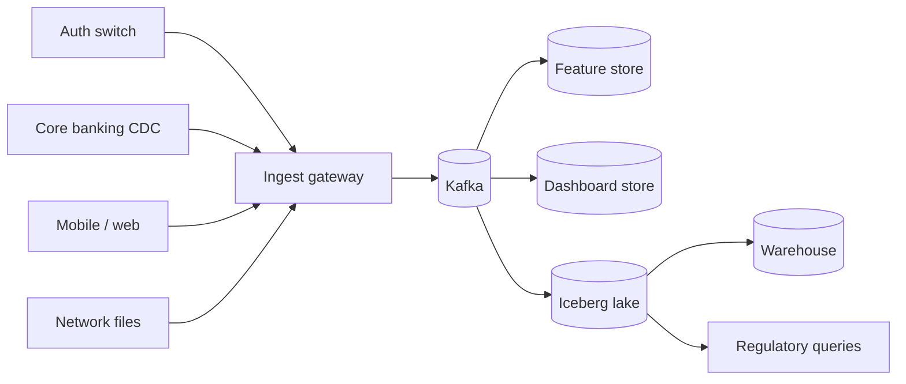
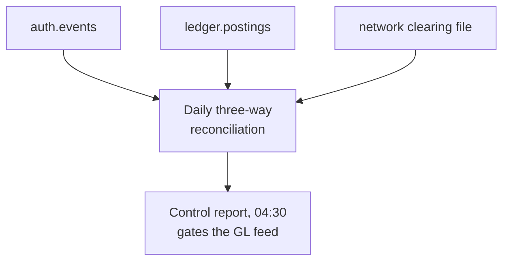

# The Interview Itself: Forty-Five Minutes, the Whiteboard, and the Questions

Everything before this document is the material. This document is how to deliver it inside a
45-minute system design interview, where the constraint is not knowledge but time and ordering.

---

## How the 45 minutes actually divide

A rough allocation that works. The exact minutes do not matter; the *proportions* do, and the
biggest mistake is spending too long on the first box you draw.

| Minutes | What you are doing | Why |
|---|---:|---|
| 0–6 | Interrogate the requirement. Decompose "billions." Establish the four consumers and their freshness SLOs | This is the highest-signal part of the whole interview and it is the part candidates rush |
| 6–10 | Capacity numbers out loud: events, bytes, peak, retention | Establishes that everything after this is grounded |
| 10–22 | Draw the architecture in three passes | The actual design |
| 22–32 | Go deep where the interviewer steers you — usually fraud features or the ledger | This is where level is assessed |
| 32–40 | Correctness, compliance, failure modes, cost | The bank-specific content most candidates never reach |
| 40–45 | Trade-offs you would revisit, and what you would build first | Signals judgment and prioritisation |

The two things that go wrong with time:

**Spending 15 minutes on ingestion.** It feels productive because there is a lot to say about
Kafka. It is the least differentiated part of the answer and it consumes the time you needed for
reconciliation.

**Never reaching compliance.** At a bank this is where the distinguishing content lives. If you are
at minute 32 and have not said anything about reproducibility or reconciliation, stop whatever
you are doing and go there.

---

## Minutes 0–6: the opening

Do not start drawing. Start with this, more or less verbatim:

> Before I design anything, I want to take apart the word "transactions," because at a card issuer
> it hides a factor of thirty.
>
> If we are a mid-size issuer — say 60 million accounts, 95 million cards — we are doing roughly
> 100 million card authorizations a day. That is about 1,150 a second, peaking around 6,400 on
> Black Friday. It is not billions.
>
> We get to billions by counting everything the authorizations generate and everything that happens
> alongside them: a risk decision per authorization, several rule-hit records each, two ledger
> postings per approval, core banking change data, the network clearing files, and — the big one —
> a couple of billion mobile and web clickstream events from 18 million app users. That is about 3
> billion events a day.
>
> So roughly 3% of this volume is money and 97% is not. The 3% needs exactly-once semantics,
> double-entry validation, and seven-year immutable retention. The 97% can lose a tenth of a
> percent and nobody is harmed. If I build one pipeline for both, I either make the clickstream
> ruinously expensive or make the ledger unsafe.
>
> So the structure of my answer is going to be tiers, not a pipeline. Does that framing work for
> you, or is there a specific part you want me to focus on?

That last question matters. It invites the interviewer to steer, which they will do anyway, and it
is better to be steered at minute six than at minute twenty-five.

Then establish the consumers, which is the second half of the opening:

> Four consumers, with freshness requirements spanning four orders of magnitude. Fraud decisioning
> needs features two seconds fresh, because a card-testing attack completes in twenty minutes.
> Analysts watching an attack need sixty seconds. Merchant and partner reporting needs T+1 by
> 06:00. And regulatory extracts have no latency requirement at all — but they have the strictest
> correctness requirement in the system, which is the ability to reproduce exactly what we knew on
> any past date.
>
> That last one is the opposite of what people expect, and it constrains the design more than the
> fraud path does.

If you say nothing else in 45 minutes, say that.

---

## Minutes 6–10: numbers out loud

Say these, deriving as you go. Do not read them from a list; derive two or three and assert the
rest.

```
1,150 auth/s × 86,400 s      = 99.4 M authorizations/day
  sanity check: ÷ 95 M cards  = 1.05 per card per day  ✓
93.7% approval                = 93.1 M approvals
  × 2 postings (double entry)  = 186 M, plus adjustments → 212 M postings/day
clickstream                    = 2.1 B events/day  (24,300/s avg, 68,000/s peak)
total                          ≈ 3.06 B events/day
raw bytes                      ≈ 2.48 TB/day
compressed at 6.8:1            ≈ 365 GB/day
retention tiered per stream    → 300 TB steady state, not 933 TB
S3 cost                        ≈ $1,825/month
```

Say the sanity check out loud. "One transaction per card per day — that is believable for a
general-purpose portfolio" takes four seconds and demonstrates that you check your own arithmetic.

And say the 150-millisecond budget, because it sets up everything in the fraud section:

> The authorization has a 150-millisecond budget at p99.9, because past that the network stands in
> for us and we lose the ability to decline. Of that, the data platform gets about 8 milliseconds.
> Not to compute anything — to read something already computed. That single fact determines the
> whole real-time design.

---

## Minutes 10–22: the whiteboard, in three passes

Draw in passes rather than all at once. Each pass is a complete, defensible system; if you are
interrupted after pass one you have still answered the question.

### Pass one: sources, log, four materialisations



While drawing, say the organising claim:

> The log is the only system of record. Everything to the right of it is a materialisation that can
> be deleted and rebuilt from the log. That is what makes a transform bug a re-run instead of an
> incident.

### Pass two: annotate with the decisions

Go back over the same diagram and add, verbally:

- **On the gateway:** "Tokenization happens here, inside the existing cardholder data environment,
  before anything is published. If I mask downstream instead, Kafka and Flink and every
  dead-letter topic are in PCI scope. This one decision keeps the entire analytical estate out of
  scope."
- **On the switch-to-gateway arrow:** "Asynchronous, through a ring buffer that spills to local
  disk, sized for a four-hour outage. If I publish synchronously, a routine Kafka leader election
  becomes 25,000 authorizations the network has to stand in for."
- **On Kafka:** "Keyed by `account_id`. By card breaks ledger ordering when two cards share a
  limit; by merchant gives 96× skew at the midnight subscription burst."
- **On the feature store:** "Flink writes it; the auth path reads it. The pipeline is never in the
  request path, because a stream processor has a batch system's availability profile and the auth
  path needs five nines."
- **On the lake:** "Iceberg, not Parquet in folders — atomic commits, hidden partitioning so a
  filter on event time prunes without the analyst knowing the layout, and snapshots, which are how
  we answer 'what did the record say on 3 March 2024.'"

### Pass three: the controls

Add the boxes most candidates never draw, and introduce them with the reason:



> Internal consistency proves nothing, because a systematic bug is internally consistent. If my
> gateway drops every transaction with a particular currency code, every store downstream agrees
> perfectly about a set that is missing 0.3% of its members. The only thing that catches that is
> comparing against a party who did not share my bug — which, at an issuer, is the network's daily
> clearing file.

That paragraph is the single highest-signal thing you can say in this interview. It is specific to
banking, it shows you understand the difference between a system being up and a system being
right, and it is not in any general system design curriculum.

---

## The questions, with spoken answers

Tiered roughly by what they are probing. The answers are what you would actually say, at the
length you would actually say it.

### Tier 1: screening

**"Walk me through what happens to one transaction."**

> A customer taps at a terminal. The acquirer sends an ISO 8583 authorization request through
> Visa to our switch. The switch validates it, looks up account state, reads about 47 features
> from a key-value store in 8 milliseconds, runs a fraud model in 31 milliseconds, evaluates
> rules, and answers approve or decline — all inside 150 milliseconds. Asynchronously, it drops
> the authorization event and the risk decision into a ring buffer, which a publisher thread
> drains to Kafka.
>
> From Kafka, four things happen in parallel. Flink updates the velocity features for that card
> and account, so the next transaction sees them — that loop closes in about 1.4 seconds. A ledger
> consumer writes two balanced postings. A feed writes the conformed fact into ClickHouse for the
> analyst dashboards, visible in about 5 seconds. And a micro-batch writer appends it to the
> Iceberg lake every 15 minutes.
>
> The next day, the network sends a clearing file saying what actually settled, and a
> reconciliation joins all three records on a composite transaction identifier.

**"Why Kafka rather than writing directly to the warehouse?"**

> Four reasons. The authorization switch would otherwise have four dependencies instead of one.
> Adding a fifth consumer would mean redeploying the most change-averse system in the bank. If a
> loader has a bug for six weeks there is nothing to re-read from. And when two stores disagree
> there is no way to determine which is right. The log gives me one source of truth and makes every
> store rebuildable from it.

**"How do you handle schema changes?"**

> Avro with a schema registry, and the compatibility mode follows deployment order rather than
> preference. Money streams use `FULL` compatibility, because I cannot upgrade 340 auth servers
> and all their consumers simultaneously — there will be hours where both versions run, and `FULL`
> is what makes that window safe. Clickstream uses `BACKWARD`, because its old producer versions
> live for months in users' phones and the consumer gets upgraded first.
>
> For a genuinely incompatible change — where a field's meaning changes rather than its presence —
> I create `auth.events.v2`, dual-publish, migrate consumers one at a time, and retire v1. That is
> why the topic name has a version suffix from day one.

### Tier 2: design

**"How does the fraud model get real-time features?"**

> It does not query the pipeline. It reads a key-value store that the pipeline wrote to, seconds
> earlier, asynchronously. Everything else in the real-time design follows from that one
> separation, and the reason for it is the 8-millisecond allocation — there is no computation that
> fits in 8 milliseconds, only a lookup.
>
> Flink consumes `auth.events` keyed by account, maintains bucketed counters, and upserts the
> current feature values into Redis. Thirty-one of the model's 47 features are windowed aggregates,
> which is why the streaming tier exists at all.
>
> The important consequence is the degradation behaviour. If the Flink job dies, authorizations
> continue using features frozen at the moment of death. The model gets gradually worse and
> someone is paged. Nothing stops. If I had put Flink in the request path instead, a routine
> checkpoint failure would be a card network outage.

**"Twenty-four-hour windows across 52 million cards — how do you store that?"**

> Not as retained events. A naive sliding window keeps every event so it can age them out, which
> for a 7-day window across all cards is tens of gigabytes per feature and terabytes across 31
> features.
>
> Instead, bucketed counters. For the 24-hour window, 288 five-minute buckets per card, each
> holding a count and a sum. "Last 24 hours" is a sum of 288 integers; "last hour" is the most
> recent 12. Across all five window sizes that is 596 buckets, 16 bytes each, about 9.3 KB per
> card. Add two HyperLogLog sketches for distinct merchants and distinct countries at 1.5 KB each,
> and it is 12.3 KB per card — 640 GB total, 8 GB per subtask on local NVMe.
>
> What I gave up is boundary precision: "the last 24 hours" is really "between 24 hours and 24
> hours and five minutes." No fraud signal turns on that, and the model was trained on the same
> quantisation. When streaming state is too large, the question is not how to store it more
> efficiently — it is what exactness you are paying for that nobody wants.

**"Batch or streaming for merchant reporting?"**

> Batch, and I would want to say why rather than just which. I ask four questions.
>
> What is the freshness SLO, as a number? When we asked the merchant analytics team, the first
> answer was "ideally real-time." The second question was "what time do you look at it?" — "around
> nine in the morning." So the SLO is T+1 by 06:00.
>
> What does one period of staleness cost? Zero. Not small — zero. The partner opens the file at
> 09:00 and looks at yesterday. There is no decision anyone makes differently.
>
> Is the computation incremental? Yes, it is counts and sums.
>
> What is the correctness bar? Exact but recomputable — if it is wrong we fix the job and re-run
> the day.
>
> Questions one and two settle it. And the cost difference is real: I costed the same aggregate
> both ways and it is $19 a month as a Spark job against $440 as a Flink job, because the batch job
> costs data volume while the streaming job costs uptime. Twenty-three times, for an output read
> once a day.

**"Why not just put everything in Snowflake and serve all three use cases from there?"**

> Because the three consumers are 100 times apart in concurrency and 2,500 times apart in rows per
> query, and concurrency and scan volume trade off against each other in every engine ever built.
>
> Concretely. During an attack, 40 analysts have a 9-panel dashboard refreshing every 30 seconds,
> which is 12 queries a second, each aggregating up to 100 million rows, each needing to come back
> in under 2 seconds. And it never hits the result cache, because the data changed since the last
> refresh. At about 2.5 seconds a query that is 30 in flight, roughly 8 per cluster before
> queueing, so four Medium clusters — about $10,500 a month, $127,000 a year, to serve dashboards
> to 40 people. A columnar store holding only 14 days, pre-sorted, does the same work on six nodes
> for about $2,700.
>
> But the cost is the smaller argument. The bigger one is isolation: if the reporting batch and the
> dashboards share a warehouse, then an attack at 04:00 means the analysts are queued behind a
> three-billion-row scan. The moment I give them separate warehouses to fix that, I have already
> accepted these are separate systems — I have just bought them from one vendor at warehouse prices.
>
> So: a columnar store for 14 days of facts at high concurrency, the warehouse for 13 months of
> curated tables for reporting and finance, and Trino or Athena straight onto the lake for the
> regulatory queries. That last one gets no load step at all, because 200 queries a year does not
> justify loading 300 terabytes — and querying the archived snapshot directly *is* the
> reproducibility mechanism rather than a copy of it.
>
> The warehouse ends up holding about 10 terabytes instead of 300, because it holds what warehouse
> consumers query and the lake holds everything else.

**"How do you prevent duplicate transactions?"**

> First, by knowing what makes two records the same, which is harder than it sounds. The network
> itself retransmits about 0.08% of the time when it does not get our response in time, so the
> duplicate exists before any of my infrastructure is involved — which means I cannot use an
> identifier my own system generates.
>
> No single ISO 8583 field is reliably unique either. STAN is six digits and wraps. RRN is supposed
> to be unique per acquirer and in practice is not, across all acquirers. So the transaction
> identity is a hash of seven business fields: acquirer BIN, RRN, STAN, terminal ID, local
> transaction date, amount in cents, and the card token. Deliberately redundant, so one acquirer's
> weak implementation does not break identity.
>
> It is a hash of business fields rather than a UUID specifically so it is reproducible — if I
> reprocess history, I get the same identifier and the rebuilt record still matches its own ledger
> postings.
>
> Then deduplication in the stream over a 48-hour window — 8 GB of state — and exact deduplication
> in the batch layer beyond that with a `GROUP BY` over an immutable partition. The 48 hours is
> sized for the realistic case, which is not a network retry; it is a human re-running yesterday's
> job.

### Tier 3: deep-dive and adversarial

**"Your Kafka cluster is down for six hours. What happens?"**

> Authorizations continue, because the publish is asynchronous — that is what the ring buffer is
> for. Each auth server buffers to local disk. Four hours at peak rate needs 379 MB per server, and
> we provision 2 GB, which at average rate is about four and a half days. So six hours fits with a
> lot of room, and I would want to know that number rather than assume it.
>
> Features go stale immediately. At ten minutes the runbook has fraud operations raise rule
> thresholds manually to compensate for a blind model. At sixty minutes we treat it as a fraud
> exposure event.
>
> Dashboards go stale. Nothing downstream of the lake is affected for six hours, because T+1
> reporting has that much slack.
>
> When Kafka returns, the buffers drain — six hours of backlog at roughly 10× normal throughput, so
> about 40 minutes to catch up. The feature job processes it in event-time order, which matters:
> the aggregates come out correct, just late.
>
> If the buffers had filled, the switch drops telemetry and keeps authorizing — and I would say
> that is a deliberate decision, acceptable only because the clearing file the next day tells me
> exactly how many records I am missing. The loss is bounded and measurable rather than silent.

**"The fraud team says the dashboard numbers do not match the daily report. Who is wrong?"**

> Possibly neither, and my first move is to check whether they are the same computation at all. In
> this design they are not: the dashboard aggregates `fact_authorization` in ClickHouse at query
> time, and the report aggregates the same facts in the lake. There is deliberately no streaming
> merchant-daily job to drift from the batch one, because the way you avoid the Lambda
> architecture's problem is not to pick one layer — it is to ensure no single number is computed by
> two pieces of code.
>
> So the likely explanation is late data and when each number was read. The dashboard store holds
> 14 days of facts and accepts late arrivals as they come, because it is appending facts rather
> than closing windows — so a transaction from an offline terminal arriving 40 hours late is
> inserted when it arrives, under its original event date. The daily report was computed once, over
> a day that was closed at the time.
>
> That means the dashboard almost certainly agrees *now* and did not agree when the analyst looked.
> The first thing I would do is re-run both as the same query against the lake with an explicit
> as-of time, which tells me whether this is a snapshot-timing artefact or a genuine difference.
>
> And then the more interesting question: why was this found by a user rather than by a control?
> If late arrivals routinely change a closed day's numbers after the report went out, that is a
> re-issue policy decision, not a bug — and somebody should have decided it deliberately rather
> than discovering it through a complaint.

**"How do you answer a regulator asking why a specific transaction was declined two years ago?"**

> Four things, from four places, and a design with three of them produces an answer an examiner
> will find incomplete.
>
> The decision record, with the exact 47-value feature vector that was read at decision time — not
> recomputed, logged. The model artefact and version, with its validation report and committee
> approval. The dimension values in force on that date, from type 2 slowly changing dimensions, so
> the merchant's category code is the one that applied then rather than now. And the facts as the
> record contained them then, via an Iceberg snapshot query, because if we reprocessed and
> corrected something in between, both the corrected and the original must be retrievable.
>
> Logging the feature vector is the part worth emphasising. It is about 700 of the 900 bytes in a
> decision record, so it is most of why that table is 33.5 TB over seven years — and that whole
> table costs roughly $160 a month to keep. For that, it does three things at once: it eliminates
> training-serving skew because we train on exactly what we served, it makes time leakage
> structurally impossible, and it turns this regulator question into a single-row answer.

**"A customer requests deletion of their transaction history under CCPA."**

> We lawfully refuse, and I would want to be precise about why rather than engineer around it. The
> CCPA exempts personal information collected and processed subject to the Gramm-Leach-Bliley Act,
> and transaction records held by a bank for Bank Secrecy Act recordkeeping fall in that exemption.
> Under GDPR the analogous route is Article 17(3)(b) — erasure does not apply where processing is
> necessary for compliance with a legal obligation.
>
> But that only covers part of what we hold. Clickstream, marketing attributes, and derived
> preference scores have no retention mandate and *are* deletable, so the pipeline needs row-level
> deletes in Iceberg followed by compaction — because an Iceberg delete file marks rows without
> removing the bytes, and a deletion that leaves the bytes is not a deletion.
>
> And the refusal gets logged as carefully as a deletion would: the request, the exemption relied
> on, the date, and who determined it. When a regulator asks whether we honour deletion requests,
> the answer should be a query over that table, not an assertion.

**"What is the most likely way this design fails in production?"**

> Silently, and specifically through the field allowlist. At the gateway I only admit classified
> fields, which is the right design because the alternative fails by leaking cardholder data
> instead of by dropping a column. But when the network adds a field or a new response code appears
> and nobody classifies it, it is dropped and everything stays green.
>
> And it is the whole category I would worry about, not just that one mechanism. Loud failures
> — a job crashing, a cluster unreachable — get detected in minutes, are recoverable because the
> log retained the data, and mostly resolve the same day. Silent ones take weeks to notice and the
> damage is often already copied into something downstream. I would expect a handful of silent
> failures to do more harm over a system's life than a couple of hundred loud ones.
>
> Two mitigations. Alert on any unclassified field appearing, at a rate above zero rather than as a
> number on a dashboard. And compare the daily distribution of transactions across response code,
> entry mode, merchant category, and currency against a 28-day trailing baseline, alerting on a
> four-sigma move in any bucket — because the subtle failure is not a missing day, it is a missing
> category, and row counts barely move.
>
> The recovery depends on something I would want to have decided on day one: `raw` keeps the
> complete original message as an opaque column alongside the parsed fields. That column costs about
> 340 GB a year, roughly $16, and it is the entire difference between "we reprocess six weeks" and
> "those six weeks are wrong forever." If I only keep the fields I knew to parse, I cannot recover
> from not knowing about a field.

**"What breaks first if volume grows tenfold?"**

> The partition count, and it is a consequence of a day-one decision. The feature job needs 780
> subtasks at ten times the peak, which requires at least 780 partitions, and `auth.events` has
> 240. Increasing partitions breaks key-to-partition mapping, so every key-ordered guarantee and
> every stateful consumer's keyed state is invalidated. The migration is a new topic, dual
> publishing, a parallel feature job rebuilt from a 7-day replay, and a cutover — about three
> weeks.
>
> If I could change one thing about this design with hindsight, it would be provisioning 1,200
> partitions instead of 240 on day one. It would have cost nothing measurable and saved three
> weeks. Same lesson for `maxParallelism`: set it to 32,768 rather than 1,024, because raising it
> later means rebuilding state from scratch.
>
> Everything in the batch tier scales by spending more money with no architectural change. That
> asymmetry — batch scales by spending, streaming scales by migrating — is a better argument for
> keeping the streaming tier small than cost is.

### Tier 4: organisational

**"Who owns this platform, and who owns the data in it?"**

> Different answers, deliberately. The platform team owns the log, the lake, the processing
> framework, the controls, and the SLOs on freshness and completeness. They do not own the meaning
> of any field.
>
> Each stream has a producing team that owns its schema and its semantics — the authorization
> platform owns `auth.events`, the fraud team owns `risk.decisions`, the app team owns clickstream.
> When the meaning of a field changes, that is their change to make and their consumers to notify,
> and the schema registry's compatibility rules are what make it mechanical rather than a meeting.
>
> The thing I would insist on: **every materialised aggregate has a named owner and a named
> consumer**, and one with neither is dropped at the quarterly review. Otherwise you accumulate
> forty aggregate tables, each built for one dashboard, each needing backfill when the facts are
> reprocessed, each able to silently stop refreshing.

**"How do you get a team of eight to build this without a two-year project?"**

> Not in the order I have just described it in — describing a system and building one want
> different sequences. The sequence I would actually run, each stage useful on its own:
>
> First, the log and the raw lake, with tokenization at the edge. Two months. At the end of it
> nothing has improved for any consumer, but every future stage is possible and — critically — the
> PCI scope decision is locked in correctly, which is the only decision here that is genuinely
> expensive to reverse.
>
> Second, the reconciliation and the control report, before any consumer migrates. One month. This
> is counterintuitive because it serves no user, and it means that when we do migrate consumers we
> can prove the new numbers match the old ones. Without it, every migration is an argument.
>
> Third, the fraud feature store. Two months. This is the one with $3.2 million a month attached,
> and it is the one that justifies the programme to everyone who is not an engineer.
>
> Fourth, the conformed layer and the warehouse, and migrate reporting consumers one at a time with
> both systems running in parallel and compared. Three months.
>
> Fifth, retire Harbinger's 23 deletion cron scripts and replace them with the retention
> reconciler, and only then turn off the old warehouse. One month.
>
> Nine months, five stages, each independently useful, with the irreversible decision made first
> and the highest-value consumer third rather than first — because feeding it before the
> reconciliation exists means we cannot prove it is right.

---

## Signals and anti-signals

What distinguishes answers, compressed.

**Strong signals:**

| Signal | Example from this collection |
|---|---|
| Interrogating the premise | "Billions" decomposed into 3% money and 97% not, in the first two minutes |
| Numbers with derivations | "1,150/s × 86,400 = 99.4 million, and ÷ 95 million cards = 1.05 per card, which is believable" |
| Knowing where money differs from data | Double-entry, balanced batches, a derived rather than stored balance |
| Correctness proved externally | Three-way reconciliation against the network's clearing file |
| Latency reasoned numerically | "8 milliseconds of a 150-millisecond budget, so a lookup not a computation" |
| Compliance as a constraint | Tokenize before the log, so the lake is out of PCI scope |
| Naming a deliberate loss | "Drop telemetry, keep authorizing — bounded because the clearing file quantifies it" |
| Saying when not to build it | "Under 5 million a day, one Postgres instance with partitioned tables" |
| Knowing what you would change | "1,200 partitions instead of 240, with hindsight" |

**Anti-signals:**

| Anti-signal | Why it costs you |
|---|---|
| "Real-time" without a number | Shows you have not had to hit a latency SLO |
| Streaming everything | Shows you have not paid streaming's operational cost |
| Masking PII as a transform step | Shows you do not know what PCI scope means, which is the single most consequential thing to know here |
| An eight-minute warehouse comparison | Not what is being tested, and it costs the time you needed for reconciliation |
| "Exactly-once" with no account of what it protects | Ask instead whether the write can be made idempotent; usually it can, and then you do not need it |
| Treating compliance as the last slide | At a bank it is the strictest requirement in the system |
| Lag measured in messages | "4.2 million messages behind" tells nobody whether to wake up |
| Defaulting a missing feature to zero | Tells the fraud model the card has had no activity |
| No mention of how it fails | The question "what keeps you up at night" is coming |

---

## The numbers worth memorising

If you remember twelve numbers, these:

```
 1.  99.4 M     authorizations per day     (1,150/s × 86,400)
 2.  6,400/s    peak, 5.6× average
 3.  3.06 B     total events per day — 3.2% of which is money
 4.  212 M      ledger postings per day (double entry)
 5.  2.48 TB    raw per day → 365 GB compressed at 6.8:1
 6.  300 TB     lake steady state (933 TB without per-stream retention)
 7.  150 ms     authorization budget; 8 ms of it for the pipeline
 8.  2 s        fraud feature freshness SLO
 9.  12.3 KB    feature state per card → 640 GB total
10.  $3.2 M     monthly fraud loss avoided by 2-second vs 15-minute features
11.  $41,600    monthly platform cost — 1.3% of that saving
12.  23×        cost of the same aggregate in streaming vs batch
```

And three sentences:

> *The log is the only system of record; every store is a rebuildable materialisation of it.*

> *Internal consistency proves nothing, because a systematic bug is internally consistent.*

> *The compliance consumer has the weakest latency requirement and the strongest correctness
> requirement, which is the opposite of what most designs assume.*

---

## What to take away

1. **Spend the first six minutes interrogating the requirement, not drawing.** Decomposing
   "billions" into 3% money and 97% not is the highest-signal move available and it is the one
   candidates rush.
2. **Invite steering at minute six.** You will be steered anyway; earlier is better.
3. **Derive two or three numbers out loud and sanity-check one of them.** "1.05 transactions per
   card per day, which is believable" costs four seconds and buys credibility for every number
   after it.
4. **Draw in three passes** — sources and log and materialisations, then the decisions annotated
   onto them, then the controls — so that being interrupted still leaves a complete answer.
5. **If you are at minute 32 and have not reached reconciliation or reproducibility, go there
   now.** At a bank that is where the distinguishing content lives.
6. **The three-way reconciliation against the network's clearing file is the single highest-signal
   thing to say.** It is specific, it separates liveness from correctness, and it is not in any
   general system design curriculum.
7. **Answer "batch or streaming" with the four-question procedure, not an adjective** — SLO as a
   number, quantified cost of staleness, incrementality, correctness bar.
8. **Have the cost per transaction and one comparison ready.** $0.0138 per thousand
   authorizations, 1.3% of what the fraud tier saves.
9. **Be ready to name what you would change with hindsight** (1,200 partitions, not 240) and **what
   you would build first** (the log and tokenization, then reconciliation, then fraud features) —
   both are judgment questions disguised as design questions.
10. **Say when not to build it.** Under 5 million transactions a day this is all the wrong answer,
    and knowing that is itself a strong signal.
